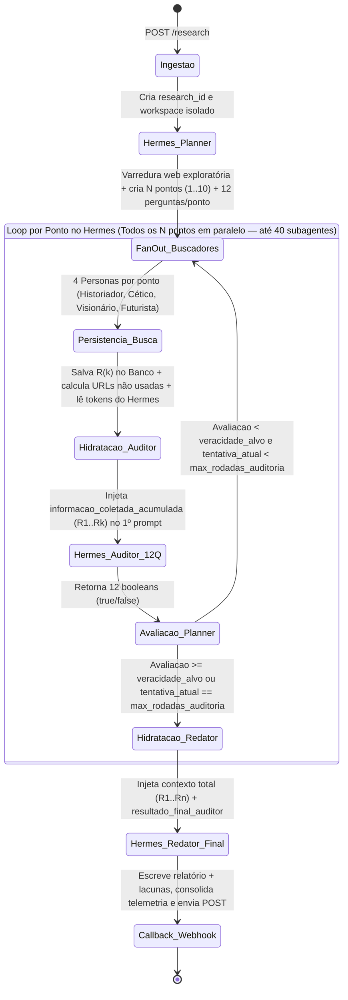

# SPEC — Especificação Técnica: Hermes Deep Research

**Versão:** 1.2  
**Core Engine:** Hermes (`hermes-agent` + perfil `deep-research` + plugin `por_papel`)  

---

## 1. Arquitetura de Execução e Máquina de Estados

O sistema **não faz chamadas diretas a APIs externas de LLM ou de busca** a partir do código Python. O backend atua exclusivamente como camada de persistência, hidratação de prompts a partir do banco de dados, configuração dinâmica do perfil Hermes (`config.yaml`) e acompanhamento do processo **Hermes**, que realiza todo o trabalho pesado de varredura web, delegação paralela de subagentes (`delegate_task`), auditoria e redação.



---

## 2. Configuração do Perfil Hermes (`config.yaml`) e Escala de 40 Subagentes

Toda a configuração operacional do Hermes vive em `hermes_home/profiles/deep-research/config.yaml` e é gerenciada em tempo de execução pelo endpoint `GET /config` e `PUT /config` (alias `/api/v1/settings`).

### 2.1. Estrutura Canônica do `hermes_home/profiles/deep-research/config.yaml`

```yaml
model:
  default: "deepseek/deepseek-v3.2"
  provider: custom
  base_url: "http://9router:20128/v1"
  api_key: "${LLM_API_KEY}"

delegation:
  # Plugin instalado em $HERMES_HOME/plugins/por_papel (opt-in via plugins.enabled)
  backend: por_papel
  # planner (depth 0) -> subagentes (depth 1); 2 permite sub-delegação controlada
  max_spawn_depth: 2
  # 10 pontos simultâneos x 4 personas = até 40 subagentes concorrentes por rodada
  max_concurrent_children: 40
  # 0 = sem teto acumulado. Escopo do teto real, profundidade 10 e max_rodadas 10:
  # 10 rodadas x (40 buscas + 10 auditorias) + 10 redatores = 510 filhos por pesquisa,
  # sempre no máximo 40 simultâneos. O agente principal (delegador) não é filho.
  oneshot_max_children: 0
  backends:
    por_papel:
      modelos:
        planner: "deepseek/deepseek-v3.2"
        historiador: "deepseek/deepseek-v3.2"
        cetico: "deepseek/deepseek-v3.2"
        visionario: "deepseek/deepseek-v3.2"
        futurista: "deepseek/deepseek-v3.2"
        auditor: "deepseek/deepseek-v3.2"
        redator: "deepseek/deepseek-v3.2"
```

### 2.2. Regras de Delegação, Modelos por Papel e Isolamento

1. **Roteamento de Modelo por Subagente (`backend: por_papel`):**
   - O plugin `delegation_por_papel` (instalado no diretório de plugins bundled do Hermes `/opt/hermes/plugins/delegation/por_papel`) intercepta cada `delegate_task` do Hermes e seleciona o modelo específico configurado para o papel da tarefa (`planner`, `historiador`, `cetico`, `visionario`, `futurista`, `auditor`, `redator`) a partir do `MODELS.json` gravado no workspace da pesquisa e do bloco `delegation.backends.por_papel.modelos` do `config.yaml`.
2. **Capacidade de 40 Subagentes Simultâneos (Zero Limite de 3 Pontos Paralelos):**
   - Não existe `max_pontos_paralelos: 3`. Quando `profundidade = 10`, todos os 10 pontos acionam suas 4 personas em paralelo, totalizando **40 subagentes simultâneos** (`max_concurrent_children: 40`).
3. **Isolamento Estrito de Workspace por Pesquisa:**
   - Cada `research_id` possui um diretório próprio isolado (`data/workspaces/{research_id}/`). O processo Hermes roda com `cwd` fixado nesse diretório, recebe `DR_WORKSPACE` apontando para ele e é instruído (SOUL do perfil) a não ler nem escrever fora dele; a partição física de acesso é responsabilidade do perfil de container onde o Hermes executa, não há `chroot` por pesquisa.
4. **Rastreamento Real de Tokens e Telemetria (`state.db` do Hermes):**
   - O backend extrai os tokens reais (`prompt_tokens`, `completion_tokens`, `reasoning_tokens`, `total_tokens`), `tool_calls` e `reasoning_trace` diretamente do banco de sessões do Hermes (`state.db` filtrado pelo `cwd`/workspace da pesquisa) e dos recibos de execução de cada subagente. Cada lote também registra o agente principal que delegou em `agent_executions` com `agent_role = 'orquestrador'`, garantindo que 100% dos tokens gastos pelo agente principal e por todos os subagentes delegados sejam somados em `research_runs`. Quando o `state.db` não está acessível, o `usage.json` do processo (`--usage-file`) é gravado na linha `orquestrador`: os tokens medidos são os do delegador, não dos filhos, e nenhum valor é inventado.

---

## 3. Estratégia de Execução e Injeção no 1º Prompt (Banco + Hermes)

1. **Varredura Exploratória do Planner (`spawn_planner`):**
   - O Planner no Hermes recebe o `tema`, `profundidade`, `veracidade_alvo`, `max_rodadas_auditoria` e `atualidade`.
   - Ele executa uma **busca exploratória simples na web** (`web_search` e abertura livre de páginas com `web_extract`) apenas para coletar contexto suficiente sobre o estado atual do tema e, em seguida, formula os `N` pontos estruturados com `subperguntas`, `hipoteses`, `lacunas_iniciais` e as 12 `perguntas_auditoria`.
2. **Quando o Hermes dispara os Buscadores (`spawn_buscadores(research_id, ponto_id, rodada)`):**
   - Se `rodada == 1`, o backend monta o 1º prompt para cada uma das 4 personas com `tema`, `atualidade`, `ponto_enunciado`, `subperguntas`, `hipoteses` e `lacunas_iniciais`.
   - Se `rodada > 1`, o backend consulta no banco quais perguntas receberam `false` no auditor da rodada anterior (`perguntas_auditoria_pendentes`) e reúne todas as `urls_lidas` acumuladas daquele ponto (`urls_lidas_ignoradas`), injetando os dois conjuntos no 1º prompt dos 4 buscadores.
3. **Quando o Hermes dispara o Auditor (`spawn_auditor(research_id, ponto_id, rodada)`):**
   - O backend executa um `SELECT` em `agent_executions` daquele ponto desde a rodada 1 até a rodada atual (`R1..Rk`), concatena integralmente `informacao_coletada` de todas as personas e rodadas sem qualquer resumo ou corte, e injeta no 1º prompt do auditor junto com `atualidade` e `perguntas_auditoria`.
4. **Quando o Hermes dispara o Redator (`spawn_redator(research_id, ponto_id)`):**
   - O backend reúne `informacao_coletada_acumulada_integral` (`R1..Rn`), `urls_usadas_acumuladas` e `resultado_final_auditor` e injeta no 1º prompt do redator daquele ponto.

---

## 4. Convenção Canônica de Nomes e Contratos

Os nomes abaixo são os únicos nomes oficiais do sistema e devem ser usados em todos os payloads de entrada, saída e persistência:

- `research_id`
- `tema`
- `profundidade`
- `veracidade_alvo`
- `max_rodadas_auditoria`
- `atualidade`
- `callback_url`
- `ponto_id`
- `enunciado`
- `subperguntas`
- `hipoteses`
- `lacunas_iniciais`
- `perguntas_auditoria`
- `tentativa_atual`
- `urls_usadas`
- `urls_lidas`
- `urls_lidas_nao_usadas`
- `informacao_coletada`
- `informacao_coletada_acumulada`
- `informacao_coletada_acumulada_integral`
- `perguntas_respondidas`
- `resultado_final_auditor`

---

## 5. Contratos JSON (Schemas de Entrada, Configuração e Saída)

### 5.1. Payload inicial do usuário (`POST /research`)
```json
{
  "tema": "matriz energetica no Brasil.",
  "profundidade": 10,
  "veracidade_alvo": 90,
  "max_rodadas_auditoria": 4,
  "atualidade": "24H",
  "callback_url": "https://webhook.callback.com"
}
```

### 5.2. Payload de Configuração do Hermes (`GET /config` e `PUT /config`)
```json
{
  "base_url": "http://9router:20128/v1",
  "api_key": "sk-...",
  "default_model": "deepseek/deepseek-v3.2",
  "max_concurrent_children": 40,
  "max_spawn_depth": 2,
  "oneshot_max_children": 0,
  "modelos_por_papel": {
    "planner": "deepseek/deepseek-v3.2",
    "historiador": "gemini/gemini-3.5-flash-lite",
    "cetico": "deepseek/deepseek-v3.2",
    "visionario": "gemini/gemini-3.5-flash-lite",
    "futurista": "gemini/gemini-3.5-flash-lite",
    "auditor": "ocg/deepseek-v4.1-flash",
    "redator": "ocg/deepseek-v4.1-flash"
  }
}
```

### 5.3. Saída do planner (após varredura exploratória inicial no Hermes)
```json
{
  "research_id": "123ABC321",
  "tema": "matriz energetica no Brasil.",
  "profundidade": 10,
  "veracidade_alvo": 90,
  "max_rodadas_auditoria": 4,
  "atualidade": "24H",
  "callback_url": "https://webhook.callback.com",
  "pontos": [
    {
      "ponto_id": 1,
      "enunciado": "Quais são as matrizes energéticas do Brasil e sua participação atual",
      "subperguntas": [
        "Qual o percentual atual de renováveis vs não-renováveis?",
        "Como se divide a geração hidráulica, térmica, eólica e solar?",
        "Quais foram as atualizações oficiais mais recentes?"
      ],
      "hipoteses": [
        "Fontes renováveis representam mais de 45% da matriz energética total.",
        "A geração solar distribuída cresceu acima da média histórica no último ciclo.",
        "Gargalos de transmissão limitam o escoamento no Nordeste."
      ],
      "lacunas_iniciais": [
        "Dados consolidados das últimas 24 horas do ONS.",
        "Impacto exato do curtailment eólico recente.",
        "Diferença metodológica entre dados da EPE e da ANEEL."
      ],
      "perguntas_auditoria": {
        "1": "As fontes primárias oficiais (EPE, ANEEL ou ONS) foram citadas?",
        "2": "Há distinção clara entre matriz energética e matriz elétrica?",
        "3": "Os percentuais de participação de cada fonte somam valores consistentes?",
        "4": "Os dados respeitam a janela de atualidade exigida (24H)?",
        "5": "A capacidade instalada em GW foi informada?",
        "6": "Há dados específicos sobre biomassa e derivados de cana?",
        "7": "Há dados sobre combustíveis fósseis (petróleo, gás e carvão)?",
        "8": "Eventuais divergências numéricas entre fontes foram explicadas?",
        "9": "As tendências de expansão de curto/médio prazo foram mapeadas?",
        "10": "Os riscos operacionais e de infraestrutura foram levantados?",
        "11": "Há contextualização histórica da evolução dessa matriz?",
        "12": "As projeções de longo prazo estão ancoradas em planos decenais ou dados reais?"
      }
    }
  ]
}
```

### 5.4. Payload de entrada do subagente buscador no Hermes
```json
{
  "research_id": "123ABC321",
  "ponto_id": 1,
  "rodada": 2,
  "persona": "historiador",
  "tema": "matriz energetica no Brasil.",
  "atualidade": "24H",
  "ponto_enunciado": "Quais são as matrizes energéticas do Brasil e sua participação atual",
  "subperguntas": [
    "Qual o percentual atual de renováveis vs não-renováveis?",
    "Como se divide a geração hidráulica, térmica, eólica e solar?",
    "Quais foram as atualizações oficiais mais recentes?"
  ],
  "hipoteses": [
    "Fontes renováveis representam mais de 45% da matriz energética total."
  ],
  "lacunas_iniciais": [
    "Dados consolidados das últimas 24 horas do ONS."
  ],
  "perguntas_auditoria_pendentes": {
    "4": "Os dados respeitam a janela de atualidade exigida (24H)?",
    "8": "Eventuais divergências numéricas entre fontes foram explicadas?"
  },
  "urls_lidas_ignoradas": [
    "https://url1.com.br",
    "https://url2.com"
  ],
  "max_queries": 3
}
```

### 5.5. Saída padronizada do subagente buscador
```json
{
  "research_id": "123ABC321",
  "ponto_id": 1,
  "rodada": 2,
  "persona": "historiador",
  "tema": "matriz energetica no Brasil.",
  "informacao_coletada": "Texto denso, detalhado e sem resumo prematuro contendo todos os fatos, números, citações e evidências extraídas das leituras via web_search e web_extract...",
  "urls_usadas": [
    "https://www.epe.gov.br/pt/publicacoes-dados-abertos/publicacoes/balanco-energetico-nacional"
  ],
  "urls_lidas": [
    "https://www.epe.gov.br/pt/publicacoes-dados-abertos/publicacoes/balanco-energetico-nacional",
    "https://portal-irrelevante-exemplo.com.br/noticia-antiga"
  ]
}
```

> O backend valida e higieniza todas as URLs e calcula automaticamente `urls_lidas_nao_usadas = urls_lidas - urls_usadas` ao persistir no banco.

### 5.6. Entrada e saída do auditor

**Entrada injetada no 1º prompt do auditor:**
```json
{
  "research_id": "123ABC321",
  "ponto_id": 1,
  "persona": "auditor",
  "atualidade": "24H",
  "soul": "Você é o auditor. Seu objetivo é avaliar rigorosamente todas as informações coletadas em todas as rodadas e responder somente com true ou false para cada uma das 12 perguntas.",
  "tentativa_atual": 2,
  "max_rodadas_auditoria": 4,
  "perguntas_auditoria": {
    "1": "...",
    "12": "..."
  },
  "informacao_coletada_acumulada": [
    {
      "rodada": 1,
      "historiador": "Informação integral da rodada 1...",
      "cetico": "Informação integral da rodada 1...",
      "visionario": "Informação integral da rodada 1...",
      "futurista": "Informação integral da rodada 1..."
    },
    {
      "rodada": 2,
      "historiador": "Informação integral da rodada 2...",
      "cetico": "Informação integral da rodada 2...",
      "visionario": "Informação integral da rodada 2...",
      "futurista": "Informação integral da rodada 2..."
    }
  ]
}
```

**Saída estrita do auditor:**
```json
{
  "research_id": "123ABC321",
  "ponto_id": 1,
  "tentativa_atual": 2,
  "perguntas_respondidas": {
    "1": true,
    "2": true,
    "3": true,
    "4": true,
    "5": true,
    "6": true,
    "7": true,
    "8": false,
    "9": true,
    "10": true,
    "11": true,
    "12": true
  }
}
```

### 5.7. Decisão de avaliação de veracidade
```json
{
  "research_id": "123ABC321",
  "tentativa_atual": 2,
  "tema": "matriz energetica no Brasil.",
  "avaliacao_pontos": [
    {
      "ponto_id": 1,
      "perguntas_true": 11,
      "total_perguntas": 12,
      "porcentagem_aprovacao": 91.67,
      "meta_veracidade_alvo": 90.0,
      "aprovado": true
    },
    {
      "ponto_id": 2,
      "perguntas_true": 8,
      "total_perguntas": 12,
      "porcentagem_aprovacao": 66.67,
      "meta_veracidade_alvo": 90.0,
      "aprovado": false
    }
  ]
}
```

### 5.8. Entrada e saída do redator

**Entrada injetada no 1º prompt do redator:**
```json
{
  "research_id": "123ABC321",
  "ponto_id": 1,
  "persona": "redator",
  "soul": "Você é o redator-chefe. Seu objetivo é redigir o relatório definitivo usando 100% da base informacional coletada em todas as rodadas, citando as urls_usadas e documentando explicitamente todas as lacunas remanescentes.",
  "ponto_enunciado": "Quais são as matrizes energéticas do Brasil e sua participação atual",
  "resultado_final_auditor": {
    "1": true,
    "2": true,
    "3": true,
    "4": true,
    "5": true,
    "6": true,
    "7": true,
    "8": false,
    "9": true,
    "10": true,
    "11": true,
    "12": true
  },
  "perguntas_auditoria": {
    "1": "...",
    "8": "Eventuais divergências numéricas entre fontes foram explicadas?",
    "12": "..."
  },
  "urls_usadas_acumuladas": [
    "https://www.epe.gov.br/pt/publicacoes-dados-abertos/publicacoes/balanco-energetico-nacional"
  ],
  "informacao_coletada_acumulada_integral": [
    {
      "rodada": 1,
      "historiador": "...",
      "cetico": "...",
      "visionario": "...",
      "futurista": "..."
    },
    {
      "rodada": 2,
      "historiador": "...",
      "cetico": "...",
      "visionario": "...",
      "futurista": "..."
    }
  ]
}
```

**Saída do redator:**
```json
{
  "research_id": "123ABC321",
  "ponto_id": 1,
  "relatorio_ponto": "## 1. Composição da Matriz Energética Brasileira\n\nTexto analítico completo e aprofundado...",
  "lacunas_identificadas": "Embora os dados de participação e capacidade instalada tenham sido confirmados, permaneceu uma lacuna quanto à reconciliação metodológica entre os números parciais de curto prazo do ONS e o consolidado anual da EPE (item 8 da auditoria).",
  "urls_citadas": [
    "https://www.epe.gov.br/pt/publicacoes-dados-abertos/publicacoes/balanco-energetico-nacional"
  ]
}
```

---

## 6. Schema do Banco de Dados (PostgreSQL / SQLite Paritário)

```sql
CREATE EXTENSION IF NOT EXISTS "pgcrypto";

-- 1. Registro Mestre da Pesquisa
CREATE TABLE research_runs (
    research_id VARCHAR(64) PRIMARY KEY,
    tema TEXT NOT NULL,
    profundidade INT NOT NULL CHECK (profundidade BETWEEN 1 AND 10),
    veracidade_alvo NUMERIC(5,2) NOT NULL,
    max_rodadas_auditoria INT NOT NULL,
    atualidade VARCHAR(32) NOT NULL,
    callback_url TEXT NOT NULL,
    status VARCHAR(32) NOT NULL DEFAULT 'PROCESSING', -- PROCESSING, COMPLETED, FAILED
    plano_inicial JSONB,
    relatorio_final_consolidado TEXT,
    lacunas_finais_consolidadas JSONB,
    urls_usadas_globais JSONB DEFAULT '[]'::jsonb,
    urls_lidas_globais JSONB DEFAULT '[]'::jsonb,
    urls_nao_usadas_globais JSONB DEFAULT '[]'::jsonb,
    total_prompt_tokens BIGINT DEFAULT 0,
    total_completion_tokens BIGINT DEFAULT 0,
    total_reasoning_tokens BIGINT DEFAULT 0,
    total_tokens BIGINT DEFAULT 0,
    created_at TIMESTAMPTZ NOT NULL DEFAULT NOW(),
    completed_at TIMESTAMPTZ
);

-- 2. Estado Individual de Cada Ponto (1..N)
CREATE TABLE research_points (
    point_uuid UUID PRIMARY KEY DEFAULT gen_random_uuid(),
    research_id VARCHAR(64) NOT NULL REFERENCES research_runs(research_id) ON DELETE CASCADE,
    ponto_id INT NOT NULL,
    enunciado TEXT NOT NULL,
    subperguntas JSONB NOT NULL,
    hipoteses JSONB NOT NULL,
    lacunas_iniciais JSONB NOT NULL,
    perguntas_auditoria JSONB NOT NULL, -- Objeto com chaves "1" a "12"
    ultimo_resultado_auditor JSONB,     -- Objeto booleano {"1": true, ..., "12": false}
    porcentagem_aprovacao NUMERIC(5,2) DEFAULT 0,
    rodada_atual INT NOT NULL DEFAULT 1,
    aprovado BOOLEAN NOT NULL DEFAULT FALSE,
    relatorio_ponto TEXT,
    lacunas_ponto TEXT,
    UNIQUE (research_id, ponto_id)
);

-- 3. Log Imutável de Execuções de Agentes no Hermes (Telemetria + Histórico Sem Truncamento)
CREATE TABLE agent_executions (
    execution_id UUID PRIMARY KEY DEFAULT gen_random_uuid(),
    research_id VARCHAR(64) NOT NULL REFERENCES research_runs(research_id) ON DELETE CASCADE,
    ponto_id INT,                        -- NULL apenas no Planner global ou consolidador final
    rodada INT NOT NULL DEFAULT 1,
    agent_role VARCHAR(32) NOT NULL,     -- 'planner', 'historiador', 'cetico', 'visionario', 'futurista', 'auditor', 'redator', 'orquestrador'
    model_used VARCHAR(128),             -- Modelo efetivamente utilizado pelo agente/subagente no Hermes
    input_prompt_payload JSONB NOT NULL, -- Tudo o que entrou no 1º prompt do agente
    raw_output_payload JSONB NOT NULL,   -- O JSON retornado pelo agente
    informacao_coletada TEXT,            -- Preenchido pelos 4 subagentes buscadores
    reasoning_trace TEXT,                -- Pensamento bruto (<think> / reasoning_content)
    tool_calls JSONB DEFAULT '[]'::jsonb,-- Histórico completo de chamadas de ferramentas (web_search, web_extract, etc.)
    urls_usadas JSONB DEFAULT '[]'::jsonb,
    urls_lidas JSONB DEFAULT '[]'::jsonb,
    urls_lidas_nao_usadas JSONB DEFAULT '[]'::jsonb,
    prompt_tokens INT NOT NULL DEFAULT 0,
    completion_tokens INT NOT NULL DEFAULT 0,
    reasoning_tokens INT NOT NULL DEFAULT 0,
    total_tokens INT NOT NULL DEFAULT 0,
    latency_ms INT,
    created_at TIMESTAMPTZ NOT NULL DEFAULT NOW()
);

CREATE INDEX idx_executions_lookup ON agent_executions (research_id, ponto_id, rodada, agent_role);
```

---

## 7. Query de Hidratação Sem Truncamento (Backend → 1º Prompt no Hermes)

Para montar o 1º prompt do **Auditor** ou do **Redator** para um `ponto_id`, o backend executa:

```sql
SELECT
    rodada,
    jsonb_object_agg(agent_role, informacao_coletada) AS coletas_da_rodada,
    jsonb_agg(urls_usadas) AS urls_usadas_rodada,
    jsonb_agg(urls_lidas) AS urls_lidas_rodada
FROM agent_executions
WHERE research_id = $1
  AND ponto_id = $2
  AND agent_role IN ('historiador', 'cetico', 'visionario', 'futurista')
  AND informacao_coletada IS NOT NULL
GROUP BY rodada
ORDER BY rodada ASC;
```

Essa query garante que `Rodada 1 + Rodada 2 + ... + Rodada K` entrem ordenadas e 100% completas no prompt inicial do agente avaliador ou redator em uma única operação de leitura.
