# SPEC — Especificação Técnica: Hermes Deep Research

**Versão:** 1.3  
**Data:** 2026-11-07  
**Core Engine:** Hermes isolado (`engine/`, imagem `nousresearch/hermes-agent:latest`) + perfil `deep-research` + plugin `por_papel`

---

## 1. Arquitetura de Execução e Máquina de Estados

O sistema **não faz chamadas diretas a APIs externas de LLM ou de busca** a partir do código Python. O backend (`api`, porta pública **8000**) atua como camada de persistência, hidratação de prompts a partir do banco de dados, configuração (modelos/limites, nunca segredos) e acompanhamento do processo **Hermes isolado** (`engine`, porta interna **8100**, sem publish, autenticação própria `X-Engine-Token`), que realiza todo o trabalho pesado de varredura web, delegação paralela de subagentes (`delegate_task`), auditoria e redação.

```text
compose:
  api:    build Dockerfile.api, ports 8000:8000, env DR_ENGINE_URL=http://engine:8100
  engine: build engine/Dockerfile (FROM nousresearch/hermes-agent:latest),
          expose 8100 (rede interna), USER hermes, volumes workspaces + hermes_home
```



```mermaid
stateDiagram-v2
    [*] --> Ingestao: POST /research (API key)
    Ingestao --> Hermes_Planner: Cria research_id, workspace isolado, evento run.criado
    Hermes_Planner --> FanOut_Buscadores: Varredura web exploratória + cria N pontos (1..10) + 12 perguntas/ponto
    Hermes_Planner --> Hermes_Planner: Falha de validação → correção e retentativa (tentativas_por_agente)

    state "Loop por Ponto no Hermes (Todos os N pontos em paralelo — até 40 subagentes)" as LoopPonto {
        FanOut_Buscadores --> Persistencia_Busca: 4 Personas por ponto (Historiador, Cético, Visionário, Futurista)
        Persistencia_Busca --> Hidratacao_Auditor: Salva R(k) no Banco + URLs + tokens; emite fonte.lida/ponto.coletado/tokens.atualizados
        Hidratacao_Auditor --> Hermes_Auditor_12Q: Injeta informacao_coletada_acumulada (R1..Rk, compactada sem perda) no 1º prompt
        Hermes_Auditor_12Q --> Avaliacao_Planner: Retorna 12 booleans (true/false)
        Avaliacao_Planner --> FanOut_Buscadores: Avaliacao < veracidade_alvo e tentativa_atual < max_rodadas_auditoria
        Avaliacao_Planner --> Hidratacao_Redator: Avaliacao >= veracidade_alvo ou tentativa_atual == max_rodadas_auditoria ou auditor ausente
    }

    FanOut_Buscadores --> Ponto_Erro: Zero sucessos na rodada → ponto.erro, remove ponto, run segue
    Hermes_Auditor_12Q --> Hidratacao_Redator: Auditor sem saída → redator com 12×false + perguntas_nao_concluidas
    Hidratacao_Redator --> Hermes_Redator_Final: Injeta contexto total (R1..Rn, compactado) + resultado_final_auditor + perguntas_nao_concluidas
    Hermes_Redator_Final --> Ponto_Erro: Redator sem saída válida → ponto.erro, pontos_falhos
    Hermes_Redator_Final --> Callback_Webhook: Escreve relatório + lacunas, consolida telemetria + avaliacao_pontos, emite run.concluido, envia POST
    Ponto_Erro --> Callback_Webhook: Run segue com pontos restantes
    Callback_Webhook --> [*]
```

Eventos persistidos em cada transição (§8). `FAILED` só em exceção global ou zero relatórios.

---

## 2. Configuração do Perfil Hermes (`config.yaml`), Provider via Env e Escala de 40 Subagentes

Toda a configuração operacional do Hermes vive em `hermes_home/profiles/deep-research/config.yaml`, renderizado no boot do container engine pelo `engine/entrypoint.sh` a partir de variáveis de ambiente. O backend (`api`) nunca escreve segredo: com `DR_ENGINE_URL` configurado, o engine é o dono do config (`PUT /config` do backend repassa ao `PUT /config` do engine; sem engine, aplica no YAML local — dev/testes).

### 2.1. Estrutura Canônica do `config.yaml` (renderizada, nunca commitada com segredo)

```yaml
model:
  default: "ocg/deepseek-v4.1-flash"
  provider: env            # provedor SOMENTE via ambiente; nunca base_url/api_key aqui
providers:
  env:
    name: env
    base_url: "https://9router.dominuslabs.online/v1"   # espelho informativo de LLM_BASE_URL
    key_env: LLM_API_KEY                                 # nome da env, não o valor
    model: "ocg/deepseek-v4.1-flash"
delegation:
  backend: por_papel
  # planner (depth 0) -> subagentes (depth 1); 2 permite sub-delegação controlada
  max_spawn_depth: 2
  # 10 pontos simultâneos x 4 personas = até 40 subagentes concorrentes por rodada
  max_concurrent_children: 40
  # 0 = sem teto acumulado. Teto real, profundidade 10 e max_rodadas 10:
  # 10 rodadas x (40 buscas + 10 auditorias) + 10 redatores = 510 filhos por pesquisa,
  # sempre no máximo 40 simultâneos. O agente principal (delegador) não é filho.
  oneshot_max_children: 0
  backends:
    por_papel:
      modelos:
        planner: "ocg/deepseek-v4.1-flash"
        historiador: "gemini/gemini-3.5-flash-lite"
        cetico: "gemini/gemini-3.5-flash-lite"
        visionario: "gemini/gemini-3.5-flash-lite"
        futurista: "gemini/gemini-3.5-flash-lite"
        auditor: "ocg/deepseek-v4.1-flash"
        redator: "ocg/deepseek-v4.1-flash"
plugins:
  enabled: [por_papel]
```

Env obrigatórias (compose/`.env`, exemplos com placeholder):

| Variável | Dono | Efeito |
|---|---|---|
| `LLM_BASE_URL` | engine | endpoint OpenAI-compatível (ex.: `https://SEU-ROTEADOR/v1`) |
| `LLM_API_KEY` | engine | segredo; vai para `$HERMES_HOME/.env` + perfil `.env` (600) dentro do container, nunca ao YAML/API/git |
| `LLM_MODEL` | engine | default = planner (forte). Ex.: `ocg/deepseek-v4.1-flash` |
| `API_KEY` | api | chave da API pública (`DR_API_KEY` alias); compose exige definida |
| `ENGINE_TOKEN` | ambos | `api` envia como `X-Engine-Token`; engine exige em tudo exceto `GET /health` |

Overrides opcionais por papel (vazio = default do papel): `LLM_MODEL_PLANNER`, `LLM_MODEL_HISTORIADOR`, `LLM_MODEL_CETICO`, `LLM_MODEL_VISIONARIO`, `LLM_MODEL_FUTURISTA`, `LLM_MODEL_AUDITOR`, `LLM_MODEL_REDATOR`. Precedência: `LLM_MODEL_<PAPEL>` > (`LLM_MODEL` para planner) > default do papel (forte: planner/auditor/redator; leve: buscadores).

> Se um detalhe de resolução de modelo no container divergir do descrito (ex.: override vazio herdando o forte), vale o comportamento observado via `GET /config` do engine — registrar como pendência, não afirmar.

### 2.2. Regras de Delegação, Modelos por Papel e Isolamento

1. **Roteamento de Modelo por Subagente (`backend: por_papel`):**
   - O plugin `delegation_por_papel` intercepta cada `delegate_task` e seleciona o modelo do papel a partir do `MODELS.json` do workspace + bloco `delegation.backends.por_papel.modelos` do `config.yaml`.
2. **Capacidade de 40 Subagentes Simultâneos (Zero Limite de 3 Pontos Paralelos):**
   - Não existe `max_pontos_paralelos: 3`. Com `profundidade = 10`, todos os 10 pontos acionam suas 4 personas em paralelo (**40 simultâneos**, `max_concurrent_children: 40`). `latest` é o pin aceito (`nousresearch/hermes-agent:latest`; tag `0.22.5` não existe no registry).
3. **Isolamento Estrito de Workspace por Pesquisa:**
   - Cada `research_id` possui diretório próprio (`/workspaces/{research_id}/`). O engine executa com `cwd` nele e `_resolver_workspace` retorna 403 fora de `/workspaces`. A API monta `hermes_home:ro`; o engine roda como `hermes`, `expose 8100` sem publish, sem mounts do host.
4. **Rastreamento Real de Tokens e Telemetria (`state.db` do Hermes):**
   - O backend extrai tokens reais (`prompt_tokens`, `completion_tokens`, `reasoning_tokens`, `total_tokens`), `tool_calls` e `reasoning_trace` do banco de sessões do Hermes (`state.db` filtrado pelo `cwd`/workspace, montado `:ro` via `DR_HERMES_STATE_DB`) e dos recibos de cada subagente. Cada lote registra o delegador em `agent_executions` com `agent_role = 'orquestrador'`.
   - **Fallback:** sem `state.db` acessível, o `usage.json` do processo (`--usage-file`, gravado por `POST /run` no workspace) alimenta a linha `orquestrador`: os tokens medidos são os do delegador, não dos filhos, e nenhum valor é inventado.

---

## 3. Estratégia de Execução e Injeção no 1º Prompt (Banco + Hermes)

1. **Varredura Exploratória do Planner (`spawn_planner`):**
   - O Planner recebe `tema`, `profundidade`, `veracidade_alvo`, `max_rodadas_auditoria` e `atualidade`.
   - Executa busca exploratória (`web_search` + `web_extract` livre) e formula os `N` pontos com `subperguntas`, `hipoteses` e `lacunas_iniciais`, além de declarar `urls_lidas`/`urls_usadas` da varredura. NÃO gera `perguntas_auditoria`: o backend injeta as 12 ESTÁTICAS universais (`PERGUNTAS_AUDITORIA_ESTATICAS`) em cada ponto em `_planejar` antes de persistir.
2. **Quando o Hermes dispara os Buscadores (`spawn_buscadores(research_id, ponto_id, rodada)`):**
   - Se `rodada == 1`: 1º prompt com `tema`, `atualidade`, `ponto_enunciado`, `subperguntas`, `hipoteses`, `lacunas_iniciais`.
   - Se `rodada > 1`: + `perguntas_auditoria_pendentes` (só as `false` das 12 estáticas) e `urls_lidas_ignoradas` (todas as `urls_lidas` acumuladas do ponto).
3. **Quando o Hermes dispara o Auditor (`spawn_auditor(research_id, ponto_id, rodada)`):**
   - O backend executa a hidratação (§7: 2 SELECTs + agregação Python) e injeta `informacao_coletada_acumulada` (R1..Rk, **compactada sem perda**) + `compactacao{}` + `atualidade` + `perguntas_auditoria` no 1º prompt.
4. **Quando o Hermes dispara o Redator (`spawn_redator(research_id, ponto_id)`):**
   - Injeta `informacao_coletada_acumulada_integral` (R1..Rn, **compactada sem perda**) + `compactacao{}` + `urls_usadas_acumuladas` + `resultado_final_auditor` + `perguntas_nao_concluidas` + `erro_coleta`.

---

## 4. Convenção Canônica de Nomes e Contratos

Os nomes abaixo são os únicos nomes oficiais do sistema e devem ser usados em todos os payloads de entrada, saída e persistência:

- `research_id`
- `tema`
- `profundidade`
- `veracidade_alvo`
- `max_rodadas_auditoria`
- `atualidade`
- `callback_url`
- `ponto_id`
- `enunciado`
- `subperguntas`
- `hipoteses`
- `lacunas_iniciais`
- `perguntas_auditoria`
- `tentativa_atual`
- `urls_usadas`
- `urls_lidas`
- `urls_lidas_nao_usadas`
- `informacao_coletada`
- `informacao_coletada_acumulada`
- `informacao_coletada_acumulada_integral`
- `compactacao`
- `perguntas_respondidas`
- `perguntas_nao_concluidas`
- `resultado_final_auditor`
- `avaliacao_pontos`

---

## 5. Contratos JSON (Schemas de Entrada, Configuração e Saída)

### 5.1. Payload inicial do usuário (`POST /research`)

```json
{
  "tema": "matriz energetica no Brasil.",
  "profundidade": 10,
  "veracidade_alvo": 90,
  "max_rodadas_auditoria": 4,
  "atualidade": "24H",
  "callback_url": "https://webhook.callback.com"
}
```

Requer API key (quando configurada): `X-API-Key: <chave>` ou `Authorization: Bearer <chave>`. Resposta `202`: `{"research_id": "...", "status": "PROCESSING"}`.

### 5.2. Payload de Configuração do Hermes (`GET /config` e `PUT /config`, alias `/api/v1/settings`)

`PUT` aceita **somente** estes campos (omitidos = preservados). `base_url`/`api_key` só são aceitos vazios/nulos; qualquer valor não-vazio → **422**:

```json
{
  "default_model": "ocg/deepseek-v4.1-flash",
  "max_concurrent_children": 40,
  "max_spawn_depth": 2,
  "oneshot_max_children": 0,
  "modelos_por_papel": {
    "planner": "ocg/deepseek-v4.1-flash",
    "historiador": "gemini/gemini-3.5-flash-lite",
    "cetico": "gemini/gemini-3.5-flash-lite",
    "visionario": "gemini/gemini-3.5-flash-lite",
    "futurista": "gemini/gemini-3.5-flash-lite",
    "auditor": "ocg/deepseek-v4.1-flash",
    "redator": "ocg/deepseek-v4.1-flash"
  }
}
```

Resposta do `GET /config` (nunca contém segredo):

```json
{
  "base_url": "https://SEU-ROTEADOR/v1",
  "api_key": "",
  "default_model": "ocg/deepseek-v4.1-flash",
  "provider_fonte": "env",
  "max_concurrent_children": 40,
  "max_spawn_depth": 2,
  "oneshot_max_children": 0,
  "modelos_por_papel": {
    "planner": "ocg/deepseek-v4.1-flash",
    "historiador": "gemini/gemini-3.5-flash-lite",
    "cetico": "gemini/gemini-3.5-flash-lite",
    "visionario": "gemini/gemini-3.5-flash-lite",
    "futurista": "gemini/gemini-3.5-flash-lite",
    "auditor": "ocg/deepseek-v4.1-flash",
    "redator": "ocg/deepseek-v4.1-flash"
  }
}
```

`GET /health` (sempre aberto, mesmo com API key): `{"status": "ok"}`.

### 5.3. Saída do planner (após varredura exploratória inicial no Hermes)

(Igual ao PRD §3.2 — `research_id`, eco dos parâmetros, `pontos[]` com `ponto_id`, `enunciado`, `subperguntas`, `hipoteses`, `lacunas_iniciais`. O planner NÃO gera `perguntas_auditoria`: o backend injeta as 12 ESTÁTICAS idênticas em cada ponto em `_planejar` antes de persistir.)

### 5.4. Payload de entrada do subagente buscador no Hermes

```json
{
  "research_id": "123ABC321",
  "ponto_id": 1,
  "rodada": 2,
  "persona": "historiador",
  "tema": "matriz energetica no Brasil.",
  "atualidade": "24H",
  "ponto_enunciado": "Quais são as matrizes energéticas do Brasil e sua participação atual",
  "subperguntas": [
    "Qual o percentual atual de renováveis vs não-renováveis?",
    "Como se divide a geração hidráulica, térmica, eólica e solar?",
    "Quais foram as atualizações oficiais mais recentes?"
  ],
  "hipoteses": [
    "Fontes renováveis representam mais de 45% da matriz energética total."
  ],
  "lacunas_iniciais": [
    "Dados consolidados das últimas 24 horas do ONS."
  ],
  "perguntas_auditoria_pendentes": {
    "4": "Não há contradições internas relevantes entre as informações coletadas pelas 4 personas? (sim/não)",
    "8": "Números, datas, unidades, métricas e identificadores estão precisos e consistentes entre as fontes? (sim/não)"
  },
  "urls_lidas_ignoradas": [
    "https://url1.com.br",
    "https://url2.com"
  ],
  "max_queries": 3
}
```

### 5.5. Saída padronizada do subagente buscador

```json
{
  "research_id": "123ABC321",
  "ponto_id": 1,
  "rodada": 2,
  "persona": "historiador",
  "tema": "matriz energetica no Brasil.",
  "informacao_coletada": "Texto denso, detalhado e sem resumo prematuro contendo todos os fatos, números, citações e evidências extraídas das leituras via web_search e web_extract...",
  "urls_usadas": [
    "https://www.epe.gov.br/pt/publicacoes-dados-abertos/publicacoes/balanco-energetico-nacional"
  ],
  "urls_lidas": [
    "https://www.epe.gov.br/pt/publicacoes-dados-abertos/publicacoes/balanco-energetico-nacional",
    "https://portal-irrelevante-exemplo.com.br/noticia-antiga"
  ]
}
```

> O backend valida e higieniza todas as URLs e calcula automaticamente `urls_lidas_nao_usadas = urls_lidas - urls_usadas` ao persistir no banco.

### 5.6. Entrada e saída do auditor

**Entrada injetada no 1º prompt do auditor:**

(`perguntas_auditoria` = as 12 ESTÁTICAS idênticas em todos os pontos, injetadas pelo backend.)

```json
{
  "research_id": "123ABC321",
  "ponto_id": 1,
  "persona": "auditor",
  "soul": "Você é o auditor. Seu objetivo é avaliar rigorosamente todas as informações coletadas em todas as rodadas e responder somente com true ou false para cada uma das 12 perguntas.",
  "atualidade": "24H",
  "tentativa_atual": 2,
  "max_rodadas_auditoria": 4,
  "perguntas_auditoria": {
    "1": "...",
    "12": "..."
  },
  "informacao_coletada_acumulada": [
    {
      "rodada": 1,
      "historiador": "Informação da rodada 1 (compactada sem perda)...",
      "cetico": "Informação da rodada 1 (compactada sem perda)...",
      "visionario": "Informação da rodada 1 (compactada sem perda)...",
      "futurista": "Informação da rodada 1 (compactada sem perda)..."
    },
    {
      "rodada": 2,
      "historiador": "Informação da rodada 2 (compactada sem perda)...",
      "cetico": "Informação da rodada 2 (compactada sem perda)...",
      "visionario": "Informação da rodada 2 (compactada sem perda)...",
      "futurista": "Informação da rodada 2 (compactada sem perda)..."
    }
  ],
  "compactacao": {
    "linhas_antes": 1200,
    "linhas_depois": 980,
    "chars_antes": 64000,
    "chars_depois": 51000
  }
}
```

**Saída estrita do auditor:**

```json
{
  "research_id": "123ABC321",
  "ponto_id": 1,
  "tentativa_atual": 2,
  "perguntas_respondidas": {
    "1": true,
    "2": true,
    "3": true,
    "4": true,
    "5": true,
    "6": true,
    "7": true,
    "8": false,
    "9": true,
    "10": true,
    "11": true,
    "12": true
  }
}
```

### 5.7. Decisão de avaliação de veracidade (`avaliacao_pontos` — formato oficial)

O boletim agregado é o **formato oficial** de avaliação: compõe a seção `## Avaliação de veracidade` do dossiê consolidado, integra o payload do webhook e é exposto em `GET /research/{id}` (omitido enquanto o run não tem pontos avaliados). `GET /research/{id}` também expõe `auditorias[]` (histórico completo por ponto/rodada, com respostas, taxa, aprovado, modelo e tokens — rastreabilidade D-04).

```json
{
  "research_id": "123ABC321",
  "tentativa_atual": 2,
  "tema": "matriz energetica no Brasil.",
  "avaliacao_pontos": [
    {
      "ponto_id": 1,
      "perguntas_true": 11,
      "total_perguntas": 12,
      "porcentagem_aprovacao": 91.67,
      "meta_veracidade_alvo": 90.0,
      "aprovado": true
    },
    {
      "ponto_id": 2,
      "perguntas_true": 8,
      "total_perguntas": 12,
      "porcentagem_aprovacao": 66.67,
      "meta_veracidade_alvo": 90.0,
      "aprovado": false
    }
  ]
}
```

### 5.8. Entrada e saída do redator

**Entrada injetada no 1º prompt do redator:**

```json
{
  "research_id": "123ABC321",
  "ponto_id": 1,
  "persona": "redator",
  "soul": "Você é o redator-chefe. Seu objetivo é redigir o relatório definitivo usando 100% da base informacional coletada em todas as rodadas, citando as urls_usadas e documentando explicitamente todas as lacunas remanescentes.",
  "ponto_enunciado": "Quais são as matrizes energéticas do Brasil e sua participação atual",
  "resultado_final_auditor": {
    "1": true,
    "2": true,
    "3": true,
    "4": true,
    "5": true,
    "6": true,
    "7": true,
    "8": false,
    "9": true,
    "10": true,
    "11": true,
    "12": true
  },
  "perguntas_auditoria": {
    "1": "... (estática 1)",
    "8": "Números, datas, unidades, métricas e identificadores estão precisos e consistentes entre as fontes? (sim/não)",
    "12": "... (estática 12)"
  },
  "perguntas_nao_concluidas": {
    "8": "Números, datas, unidades, métricas e identificadores estão precisos e consistentes entre as fontes? (sim/não)"
  },
  "erro_coleta": null,
  "urls_usadas_acumuladas": [
    "https://www.epe.gov.br/pt/publicacoes-dados-abertos/publicacoes/balanco-energetico-nacional"
  ],
  "informacao_coletada_acumulada_integral": [
    {
      "rodada": 1,
      "historiador": "...",
      "cetico": "...",
      "visionario": "...",
      "futurista": "..."
    },
    {
      "rodada": 2,
      "historiador": "...",
      "cetico": "...",
      "visionario": "...",
      "futurista": "..."
    }
  ],
  "compactacao": {
    "linhas_antes": 2400,
    "linhas_depois": 1950,
    "chars_antes": 128000,
    "chars_depois": 102000
  }
}
```

**Saída do redator:**

```json
{
  "research_id": "123ABC321",
  "ponto_id": 1,
  "relatorio_ponto": "## 1. Composição da Matriz Energética Brasileira\n\nTexto analítico completo e aprofundado...",
  "lacunas_identificadas": "Embora os dados de participação e capacidade instalada tenham sido confirmados, permaneceu uma lacuna quanto à reconciliação metodológica entre os números parciais de curto prazo do ONS e o consolidado anual da EPE (item 8 da auditoria).",
  "urls_citadas": [
    "https://www.epe.gov.br/pt/publicacoes-dados-abertos/publicacoes/balanco-energetico-nacional"
  ]
}
```

---

## 6. Schema do Banco de Dados (PostgreSQL / SQLite Paritário)

```sql
CREATE EXTENSION IF NOT EXISTS "pgcrypto";

-- 1. Registro Mestre da Pesquisa
CREATE TABLE research_runs (
    research_id VARCHAR(64) PRIMARY KEY,
    tema TEXT NOT NULL,
    profundidade INT NOT NULL CHECK (profundidade BETWEEN 1 AND 10),
    veracidade_alvo NUMERIC(5,2) NOT NULL,
    max_rodadas_auditoria INT NOT NULL,
    atualidade VARCHAR(32) NOT NULL,
    callback_url TEXT NOT NULL,
    status VARCHAR(32) NOT NULL DEFAULT 'PROCESSING', -- PROCESSING, COMPLETED, FAILED
    plano_inicial JSONB,
    relatorio_final_consolidado TEXT,
    lacunas_finais_consolidadas JSONB,
    urls_usadas_globais JSONB DEFAULT '[]'::jsonb,
    urls_lidas_globais JSONB DEFAULT '[]'::jsonb,
    urls_nao_usadas_globais JSONB DEFAULT '[]'::jsonb,
    total_prompt_tokens BIGINT DEFAULT 0,
    total_completion_tokens BIGINT DEFAULT 0,
    total_reasoning_tokens BIGINT DEFAULT 0,
    total_tokens BIGINT DEFAULT 0,
    created_at TIMESTAMPTZ NOT NULL DEFAULT NOW(),
    completed_at TIMESTAMPTZ
);

-- 2. Estado Individual de Cada Ponto (1..N)
CREATE TABLE research_points (
    point_uuid UUID PRIMARY KEY DEFAULT gen_random_uuid(),
    research_id VARCHAR(64) NOT NULL REFERENCES research_runs(research_id) ON DELETE CASCADE,
    ponto_id INT NOT NULL,
    enunciado TEXT NOT NULL,
    subperguntas JSONB NOT NULL,
    hipoteses JSONB NOT NULL,
    lacunas_iniciais JSONB NOT NULL,
    perguntas_auditoria JSONB NOT NULL, -- Objeto com chaves "1" a "12"
    ultimo_resultado_auditor JSONB,     -- Objeto booleano {"1": true, ..., "12": false}
    porcentagem_aprovacao NUMERIC(5,2) DEFAULT 0,
    rodada_atual INT NOT NULL DEFAULT 1,
    aprovado BOOLEAN NOT NULL DEFAULT FALSE,
    relatorio_ponto TEXT,
    lacunas_ponto TEXT,
    UNIQUE (research_id, ponto_id)
);

-- 3. Log Imutável de Execuções de Agentes no Hermes (Telemetria + Histórico Integral)
CREATE TABLE agent_executions (
    execution_id UUID PRIMARY KEY DEFAULT gen_random_uuid(),
    research_id VARCHAR(64) NOT NULL REFERENCES research_runs(research_id) ON DELETE CASCADE,
    ponto_id INT,                        -- NULL apenas no Planner global ou consolidador final
    rodada INT NOT NULL DEFAULT 1,
    agent_role VARCHAR(32) NOT NULL,     -- 'planner', 'historiador', 'cetico', 'visionario', 'futurista', 'auditor', 'redator', 'orquestrador'
    model_used VARCHAR(128),             -- Modelo efetivamente utilizado pelo agente/subagente no Hermes
    input_prompt_payload JSONB NOT NULL, -- Tudo o que entrou no 1º prompt do agente
    raw_output_payload JSONB NOT NULL,   -- O JSON retornado pelo agente
    informacao_coletada TEXT,            -- Preenchido pelos 4 subagentes buscadores
    reasoning_trace TEXT,                -- Pensamento bruto (<think> / reasoning_content)
    tool_calls JSONB DEFAULT '[]'::jsonb,-- Histórico completo de chamadas de ferramentas (web_search, web_extract, etc.)
    urls_usadas JSONB DEFAULT '[]'::jsonb,
    urls_lidas JSONB DEFAULT '[]'::jsonb,
    urls_lidas_nao_usadas JSONB DEFAULT '[]'::jsonb,
    prompt_tokens INT NOT NULL DEFAULT 0,
    completion_tokens INT NOT NULL DEFAULT 0,
    reasoning_tokens INT NOT NULL DEFAULT 0,
    total_tokens INT NOT NULL DEFAULT 0,
    latency_ms INT,
    created_at TIMESTAMPTZ NOT NULL DEFAULT NOW()
);

CREATE INDEX idx_executions_lookup ON agent_executions (research_id, ponto_id, rodada, agent_role);

-- 4. Log de eventos SSE (snapshot/replay por Last-Event-ID/desde, heartbeat, at-least-once)
CREATE TABLE research_events (
    id SERIAL PRIMARY KEY,
    research_id VARCHAR(64) NOT NULL REFERENCES research_runs(research_id) ON DELETE CASCADE,
    tipo VARCHAR(64) NOT NULL,           -- run.criado, plano.pronto, fonte.lida, ..., run.concluido
    payload JSONB NOT NULL DEFAULT '{}'::jsonb,
    created_at TIMESTAMPTZ NOT NULL DEFAULT NOW()
);

CREATE INDEX idx_events_lookup ON research_events (research_id, id);
```

SQLite local (`src/db/sqlite_manager.py`) espelha as 4 tabelas (`JSONB`→`TEXT`, `SERIAL`→`AUTOINCREMENT`). O arquivo local `data/deep_research.db` não é versionado (`data/` no `.gitignore`); `conectar()` cria as tabelas via `SCHEMA IF NOT EXISTS` no próximo open RW e o container possui as 4 tabelas.

---

## 7. Hidratação Real (Backend → 1º Prompt no Hermes) + Compactação Determinística

Implementação (`src/db/repository.py::hidratar`): **2 SELECTs + agregação em Python**, semanticamente equivalente à query de referência abaixo (ordenado por rodada, só personas buscadoras, `informacao_coletada NOT NULL`):

```python
# SELECT 1 — textos por rodada/persona
"SELECT rodada, agent_role, informacao_coletada FROM agent_executions"
" WHERE research_id = ? AND ponto_id = ? AND agent_role IN (?,?,?,?)"
" AND informacao_coletada IS NOT NULL ORDER BY rodada ASC, rowid ASC"
# SELECT 2 — URLs acumuladas (todas as roles do ponto, inclui planner)
"SELECT urls_usadas, urls_lidas FROM agent_executions"
" WHERE research_id = ? AND ponto_id = ? ORDER BY rowid ASC"
# agregação: por_rodada[rodada][persona] = texto; usadas/lidas normalizadas e deduplicadas
```

Para referência em PostgreSQL (leitura única, sem compactação — o DB é integral; a compactação ocorre depois, só no prompt):

```sql
SELECT
    rodada,
    jsonb_object_agg(agent_role, informacao_coletada) AS coletas_da_rodada,
    jsonb_agg(urls_usadas) AS urls_usadas_rodada,
    jsonb_agg(urls_lidas) AS urls_lidas_rodada
FROM agent_executions
WHERE research_id = $1
  AND ponto_id = $2
  AND agent_role IN ('historiador', 'cetico', 'visionario', 'futurista')
  AND informacao_coletada IS NOT NULL
GROUP BY rodada
ORDER BY rodada ASC;
```

**Compactação determinística antes do prompt** (`src/evidencias.py::compactar_acumulado`, aplicada em `hydrator.payload_auditor/payload_redator`): o DB nunca é reescrito. Regras — normaliza espaços; remove linhas exatamente duplicadas (primeira ocorrência vence, ordem preservada); remove ruído de navegação por lista conservadora (`compartilhar`, `aceitar cookies`, `leia mais`, breadcrumbs `home >`, etc.); **linha com dígito, URL, data ou início de citação (`"`, `fonte:`, `segundo `) nunca é removida**. Estatísticas agregadas em `compactacao{}` no payload (`linhas_antes/depois`, `chars_antes/depois`).

---

## 8. SSE: Eventos, Snapshot, Last-Event-ID/desde, Heartbeat, At-Least-Once + Dedupe Cliente, Persist-Before-Publish

- **Persist-before-publish:** `Pipeline._evento → repo.emitir_evento` (`INSERT` + commit, retorna `id`); o SSE só lê do banco (`listar_eventos`), nunca de memória.
- **Endpoint:** `GET /research/{id}/eventos` (aliases `/events`), com API key via header ou `?api_key=`. `404` se a pesquisa não existe.
- **Snapshot vs replay:** header `Last-Event-ID` vence; senão `?desde=`. `proximo <= 0` → snapshot (`id = ultimo_evento_id`, `event: snapshot`, `data` = run completo via `_consultar_run`) **seguido** de replay; `proximo > 0` → replay de eventos com `id > base`, ordem `id ASC`, limite 500/iteração.
- **At-least-once + dedupe cliente:** o replay `depois_de=proximo` pode reduplicar o que o snapshot já trouxe; o cliente **deduplica por `id`** (fonte de verdade = banco). Nunca perde, pode duplicar — "sem duplicação" estrito não é garantido por desenho.
- **Heartbeat:** `: ping` a cada `0.5s × 30 = 15s` ociosas; loop encerra em disconnect ou run removida.
- **Tipos emitidos** (payloads em `orchestrator.py`): `run.criado`, `run.status`, `plano.pronto`, `ponto.iniciado`, `fonte.lida` (`urls_lidas/usadas` como **arrays**), `ponto.coletado` (`ponto_id`, `rodada`, `urls_usadas`, `urls_lidas`, `personas`), `auditoria.executada` (inclui `perguntas_respondidas`, `model_used`, `total_tokens`, `auditor_ausente` quando aplicável), `ponto.aprovado`/`ponto.reprovado`, `redator.iniciado`, `ponto.finalizado`, `tokens.atualizados` (`tokens_execucao` = delta do lote, `tokens_por_papel`, totais cumulativos), `run.concluido` (`status`, `pontos_falhos`, `metricas_tokens`, `avaliacao_pontos`), `ponto.erro`, `run.falhou`.

---

## 9. Resiliência (Falha por Ponto, sem Aborto Global)

| Falha | Comportamento | Evento |
|---|---|---|
| Persona buscadora falha | demais seguem; bloqueio programático de re-busca mantido | — |
| Zero sucessos no ponto/rodada | ponto removido do loop, run segue | `ponto.erro` |
| Auditor sem saída | redator com 12×`false`, `auditor_ausente: true`, `perguntas_nao_concluidas`, `erro_coleta` | `auditoria.executada` + `ponto.reprovado` |
| `tentativa_atual == max` sem aprovação | `ACAO_REDATOR_LIMITE` → redator com melhor esforço | `ponto.reprovado` |
| Redator sem saída válida (após `tentativas_por_agente`) | ponto em `pontos_falhos`, seção de incompletude no dossiê | `ponto.erro` |
| Exceção global | `FAILED`, log, raise | `run.falhou` |
| Webhook falha (5 tentativas) | status segue `COMPLETED`, erro logado | — |

`FAILED` somente quando nenhum relatório é produzido ou exceção escapa ao loop. Consolidação ordena pontos `1..N`, dedupica URLs globais, soma telemetria, anexa `## Avaliação de veracidade`.

---

## 10. API Key (API Pública) e Token do Engine (Interno)

- **API pública (`api:8000`):** `_exigir_chave` — espera `DR_API_KEY` ou `API_KEY`. Fontes aceitas: header `X-API-Key`, `Authorization: Bearer <chave>`, query `?api_key=` (só SSE). Sem chave configurada → aberto (dev/testes). `GET /health` sempre aberto, mesmo com chave. Erro → `401 "API key inválida"`.
- **Engine interno (`engine:8100`):** `_auth` — tudo exceto `GET /health` exige `X-Engine-Token == ENGINE_TOKEN`; token ausente no env → `500`; inválido → `401`. Porta nunca publicada; só rede interna do compose (`depends_on`).
- **`PUT /config` com chave inválida → `401`; com credencial no payload → `422`; erro do engine repassado (`RuntimeError` após 30s ou 5xx).**

---

## 11. Compactação Determinística (Regras Finais)

Ver §7. Resumo normativo: aplicada **somente** nos prompts de auditor/redator; DB intacto; preserva números/datas/URLs/citações; remove apenas linhas duplicadas exatas e ruído da lista conservadora; estatísticas em `compactacao{}` no payload e persistidas em `input_prompt_payload` para auditoria. Testes: `tests/test_evidencias.py` (deduplicação, preservação de chaves não-texto, invariância factual).
