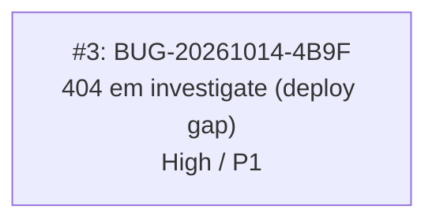

<!-- GENERATED, DO NOT EDIT: regenerado por /reversa-debugger-graph em 2026-10-14T01:34:54.495728+00:00 a partir de 1 bugs -->

# Grafo de Relações · modulo-briefing

## Impact Score
| Bug | Score | Detalhes |
|---|---|---|
| BUG-20261014-4B9F | 0 | Sem dependências bloqueadas cadastradas |
