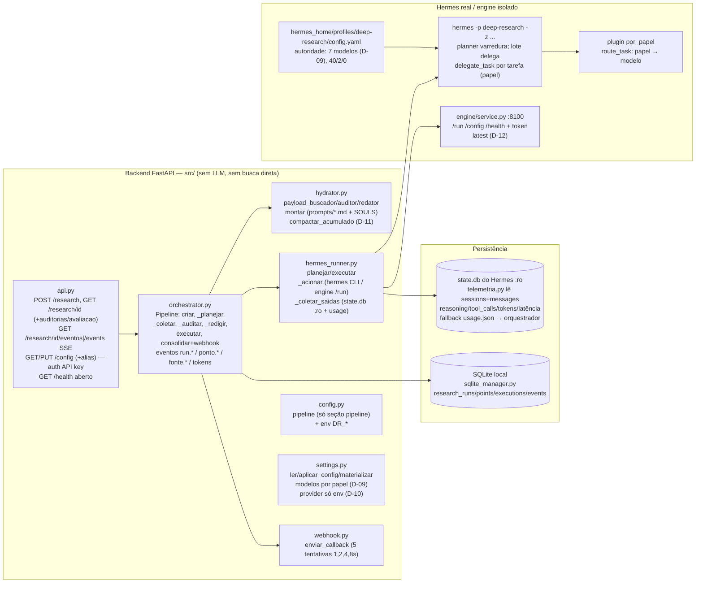

# Arquitetura real (código atual)

## Componentes e fronteiras



Fronteiras: backend nunca chama LLM nem buscador (`tests/test_garantias.py::test_backend_nao_fala_com_provedor_nem_busca_direto`); IA acontece no Hermes/engine com `cwd`=workspace (`DR_WORKSPACE`). Telemetria entra pelo `state.db` **read-only** (`mode=ro`, `src/telemetria.py:97`; volume `hermes_home:ro` no compose). Config de execução (`db_path`, `hermes_bin`, timeouts, engine) sai de `config/hermes_config.yaml` seção `pipeline` (14 linhas, sem `delegation`, sem segredo) + env; modelos/delegação saem do perfil.

## Sequência planner → coleta → auditoria → redação → consolidação → webhook

```mermaid
sequenceDiagram
    participant C as Cliente
    participant A as api.py (+auth)
    participant O as orchestrator.executar
    participant H as hermes_runner
    participant X as Hermes/engine
    participant R as repository
    participant W as webhook
    C->>A: POST /research (+key) → 202 {research_id, PROCESSING}
    A->>O: BackgroundTasks executar(research_id)
    O->>O: _planejar (PlanoLLM + urls_lidas/usadas; salvar_plano; plano.pronto)
    O->>H: executar lote (N pontos × 4 personas; INSTRUCAO_LOTE)
    H->>X: 1 delegate_task por tarefa (papel)
    O->>R: registrar_execucao por persona (blacklist) + fonte.lida/ponto.coletado
    O->>O: _auditar (payload compactado D-11; avaliar → nova rodada | encerrado; auditorias[]; auditor ausente → 12 false)
    O->>H: executar lote redator (validador por ponto)
    O->>R: salvar_relatorio por ponto + ponto.finalizado
    O->>R: consolidar → UPDATE COMPLETED + commit (ponto incompleto vira seção; avaliacao_pontos no dossiê)
    O->>O: run.concluido{status, pontos_falhos, metricas_tokens, avaliacao_pontos[]}
    O->>W: enviar_callback (5 tentativas; 4xx sem retentar)
    Note over O,W: falha do webhook: except + log, status segue COMPLETED (D-01; src/orchestrator.py:166-173)
```

## SSE (`src/api.py:76-125`)

`Last-Event-ID` vence, senão `?desde=` (+ `?api_key=` p/ EventSource); `proximo<=0` → `snapshot` (run completo via `_consultar_run`); senão replay `id>base`; heartbeat `: ping`/15s; 404 se run ausente; encerra se cliente desconecta ou run some. **At-least-once** (replay pode reduplicar o snapshot; cliente deduplica por id). Tipos: `run.criado|run.status|plano.pronto|ponto.iniciado|fonte.lida|ponto.coletado|auditoria.executada|ponto.aprovado|ponto.reprovado|redator.iniciado|ponto.finalizado|tokens.atualizados|run.concluido|ponto.erro|run.falhou`. **CONFIRMADO** (`tests/test_eventos.py:81-107`, `tests/test_api_key.py:66-87`).

## Máquina de estados

```mermaid
stateDiagram-v2
    [*] --> PROCESSING: criar (src/orchestrator.py:68-73)
    PROCESSING --> COMPLETED: consolidar (src/db/repository.py:479-493) + webhook tenta depois
    PROCESSING --> FAILED: exceção em planejar/coletar/auditar/redigir/consolidar (src/orchestrator.py:160-164)
    COMPLETED --> [*]
    FAILED --> [*]
    note right of COMPLETED: webhook pode ter falhado (só log, D-01); sem coluna de entrega
    note right of PROCESSING: ponto: pendente-coleta → auditado → nova-rodada | encerrado-redigido (dict em memória + ponto.erro se zero sucessos / auditor ausente → 12 false)
```
