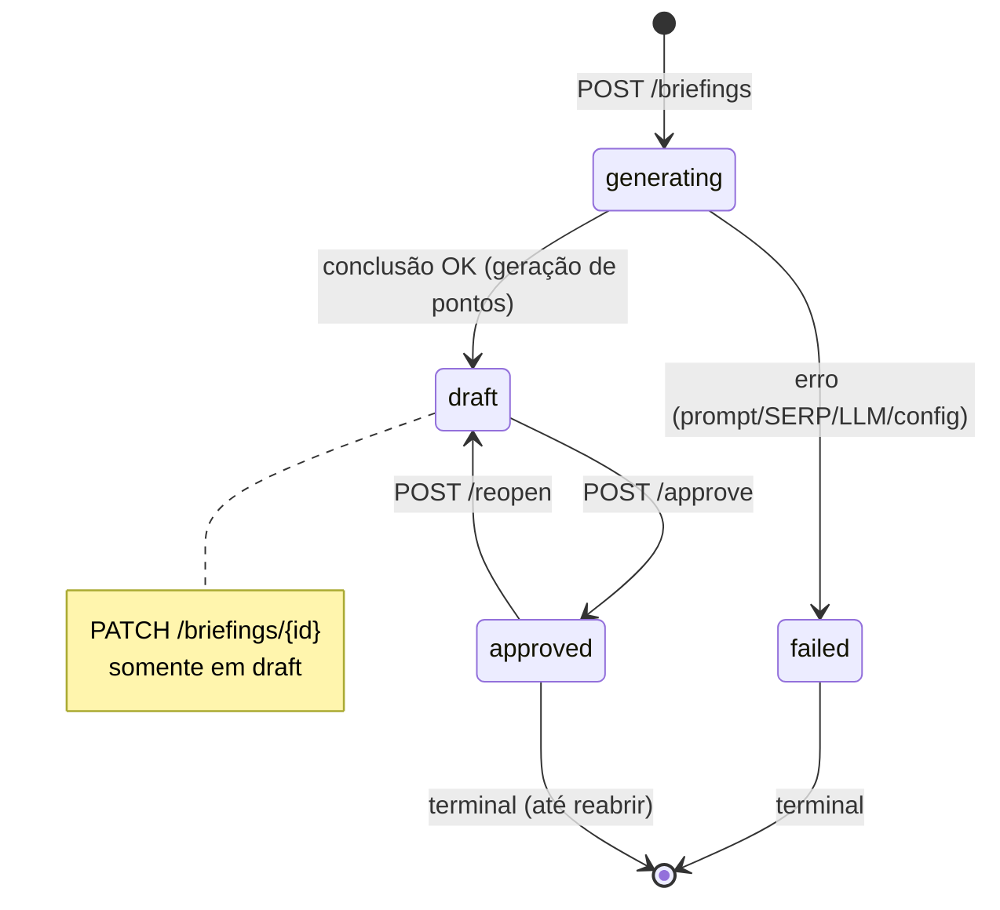

# Módulo de Briefing / Scout — Referência de API

> Documentação canônica da API de Briefings do Deep Research Engine.
>
> Conforme: `docs/standards/api-docs-standard.md` (v1, snake_case, RFC 9457, envelopes).

---

## 1. Visão Geral & Casos de Uso

> [!NOTE]
> O Módulo de Briefing / Scout é o **primeiro estágio** do pipeline de pesquisa: transforma um tema em um conjunto de 3 a 7 pontos de foco estruturados, que alimentam as etapas de pesquisa paralela (workers) e auditoria subsequente.

**Objetivo:** dado um tema (3 a 300 caracteres), gerar um *briefing* — lista de pontos com `title` e `description` — orientando uma pesquisa futura. Não responde ao tema nem apresenta conclusão.

**Papel do Scout:** atu como **explorador cognitivo**. Executa duas buscas em sequência:

1. **Busca SERP via Jina** (`https://s.jina.ai/`): consulta a API Jina Search e coleta resultados orgânicos para o tema informado.
2. **LLM (role `scout`):** processa os resultados SERP com um *prompt de sistema* (`app/prompts/briefing.md`) e um *prompt de usuário* estruturado, gerando **3 a 7 pontos centrais**. O modelo padrão é `gemini/gemini-3.8-flash`, resolvido em runtime via `AppSettings` (role `scout`).

**Casos de uso:**

| Caso | Descrição |
|---|---|
| Briefing inicial | Criação de briefing a partir de tema |
| Revisão colaborativa | Edição de pontos em rascunho |
| Aprovação formal | Aprovação do briefing como base para pesquisa |
| Reabertura | Correção pós-aprovação, retorno a rascunho |
| Consumo | Leitura do briefing aprovado por downstream |
| Auditoria | Histórico de versões (v1, v2, …) |
| Integração | Consumo via API por workers paralelos |

> [!TIP]
> A geração é **assíncrona**: `POST /briefings` retorna `201` apenas após a orquestração completar (Tx1 + Tx2). Consulte `GET /briefings/{id}` para o snapshot corrente.

---

## 2. Autenticação & Headers

Todos os endpoints exigem autenticação. O mecanismo de credencial é **exclusivo** — nunca envie mais de um tipo por requisição:

| Tipo | Header / Cookie | Observação |
|---|---|---|
| Bearer Token | `Authorization: Bearer <API_AUTH_SECRET>` | Comparação constante de tempo (`hmac.compare_digest`) |
| API Key | `X-API-Key: <API_AUTH_SECRET>` | Alternativa sem `Authorization` |
| Cookie Admin | `Cookie: dr_session=<JWT>` + `X-CSRF-Token: <csrf>` | Obrigatório para mutations (`POST/PUT/PATCH/DELETE`) |

> [!WARNING]
> Headers de identidade de tenant (`x-tenant-id`) são rejeitados com `400`. Múltiplas credenciais simultaneamente retornam `400` (ambíguo).

**Headers recomendados para todas as requisições:**

```http
Accept: application/json
Content-Type: application/json
```

---

## 3. Quickstart cURL

Fluxo completo passo a passo:

### Passo 1 — Criar briefing e aguardar draft

```bash
BRIEFING_ID=$(curl -s -X POST \
  -H "Authorization: Bearer $API_AUTH_SECRET" \
  -H "Content-Type: application/json" \
  -H "Accept: application/json" \
  https://api.deepresearchengine.com/v1/briefings \
  -d '{"theme": "impacto da IA na medicina"} \
  -w '\n%{http_code}' \
  | awk 'NR==1{print;}' )

echo "Briefing ID: $BRIEFING_ID"
```

### Passo 2 — Consultar status

```bash
curl -s \
  -H "Authorization: Bearer $API_AUTH_SECRET" \
  -H "Accept: application/json" \
  https://api.deepresearchengine.com/v1/briefings/$BRIEFING_ID | jq '.'
```

Repita até `status` ser `draft` ou `failed`.

### Passo 3 — Opcional: editar pontos com PATCH

```bash
curl -s -X PATCH \
  -H "Authorization: Bearer $API_AUTH_SECRET" \
  -H "Content-Type: application/json" \
  https://api.deepresearchengine.com/v1/briefings/$BRIEFING_ID \
  -d '{
    "points": [
      {"title": "Ponto revisado", "description": "Descrição atualizada"},
      {"title": "Novo ponto", "description": "Descrição do novo ponto"},
      {"title": "Terceiro ponto", "description": "Mais uma descrição"}
    ]
  }' | jq '.'
```

### Passo 4 — Aprovar com POST /approve

```bash
curl -s -X POST \
  -H "Authorization: Bearer $API_AUTH_SECRET" \
  -H "X-CSRF-Token: $CSRF_TOKEN" \
  -H "Content-Type: application/json" \
  https://api.deepresearchengine.com/v1/briefings/$BRIEFING_ID/approve \
  -d '{}' | jq '.'
```

### Passo 5 — Consumir aprovado via GET /briefings/approved/{id}

```bash
curl -s \
  -H "Authorization: Bearer $API_AUTH_SECRET" \
  -H "Accept: application/json" \
  https://api.deepresearchengine.com/v1/briefings/approved/$BRIEFING_ID | jq '.'
```

---

## 4. Ciclo de Vida da Entidade



**Regras de transição (domain.py):**

| De | Para | Trigger | Condição |
|---|---|---|---|
| `generating` | `draft` | geração concluída | 3–7 pontos válidos |
| `generating` | `failed` | erro interno/SERP/LLM | mensagem de erro fixa |
| `draft` | `approved` | `POST /approve` | — |
| `approved` | `draft` | `POST /reopen` | — |
| `failed` | (qualquer) | — | **terminal**, requer nova criação |

**Controle de versão:**

- Versão inicia em `v1` (status `generating`).
- Cada transição atômica **incrementa a versão** monotonicamente: `complete_briefing`, `edit_briefing`, `approve_briefing`, `reopen_briefing`, `fail_briefing`.
- Histórico append-only em `briefing_versions`, ordenado por `version ASC`.
- `GET /briefings/{id}/versions` retorna **v2 em diante** (transições pós-criação).

**Concorrência (CAS):**

- `save_briefing_transition` usa `UPDATE ... WHERE id = ? AND version = old_version`.
- Colisão (`rowcount != 1`) eleva `BriefingVersionConflictError` → **`409 Conflict`**.
- Cliente deve reexecutar leitura → PATCH/approve com versão corrente.

---

## 5. Referência dos Endpoints HTTP

### `POST /briefings` — Criar briefing

Cria e orquestra a geração do briefing do tema informado.

| Campo | Tipo | Obrigatório | Default | Descrição |
|---|---|---|---|---|
| `theme` | `string` | Sim | — | Tema do briefing. **3–300 caracteres** após trim. |

**Resposta — `201 Created`:**

```json
{
  "id": "a1b2c3d4-e5f6-7890-abcd-ef1234567890",
  "theme": "impacto da IA na medicina",
  "status": "draft",
  "points": [
    {
      "title": "Diagnóstico assistido por IA",
      "description": "Modelos de imagem médica para detecção precoce de patologias."
    },
    {
      "title": "Eficiência hospitalar",
      "description": "Automação de triage e otimização de fluxos de pacientes."
    },
    {
      "title": "Ética e vieses algorítmicos",
      "description": "Riscos de discriminação em decisões clínicas automatizadas."
    },
    {
      "title": "Regulamentação",
      "description": "Quadros normativos internacionais para validação de IA clínica."
    },
    {
      "title": "Adoção clínica",
      "description": "Barreiras de implementação em ambientes reais de saúde."
    }
  ],
  "version": 2,
  "error": null,
  "approved_at": null
}
```

> [!NOTE]
> A requisição é síncrona em termos de orquestração: `201` é retornado apenas após a geração completar (Tx1 reserva + Tx2 commit). Se falhar, o briefing fica com `status: "failed"` e `error` populado, retornado também com `201`.

---

### `GET /briefings/{id}` — Consultar snapshot corrente

Retorna o estado corrente do briefing.

| Parâmetro | Tipo | Local | Obrigatório | Descrição |
|---|---|---|---|---|
| `id` | `uuid` | path | Sim | UUID do briefing |

**Resposta — `200 OK`:**

```json
{
  "id": "a1b2c3d4-e5f6-7890-abcd-ef1234567890",
  "theme": "impacto da IA na medicina",
  "status": "draft",
  "points": [
    {
      "title": "Diagnóstico assistido por IA",
      "description": "Modelos de imagem médica para detecção precoce de patologias."
    }
  ],
  "version": 2,
  "error": null,
  "approved_at": null
}
```

---

### `PATCH /briefings/{id}` — Editar pontos

Edita os pontos do briefing em status `draft`. Versão incrementa +1.

| Parâmetro | Tipo | Local | Obrigatório | Descrição |
|---|---|---|---|---|
| `id` | `uuid` | path | Sim | UUID do briefing |

| Campo | Tipo | Obrigatório | Default | Descrição |
|---|---|---|---|---|
| `points` | `array[object]` | Sim | — | Lista de **3–7 pontos**. Cada ponto: `title` (`string`, não vazio), `description` (`string`, não vazio). |

**Resposta — `200 OK`:**

```json
{
  "id": "a1b2c3d4-e5f6-7890-abcd-ef1234567890",
  "theme": "impacto da IA na medicina",
  "status": "draft",
  "points": [
    {
      "title": "Ponto revisado",
      "description": "Descrição atualizada"
    }
  ],
  "version": 3,
  "error": null,
  "approved_at": null
}
```

---

### `POST /briefings/{id}/approve` — Aprovar briefing

Aprova o briefing em status `draft`. Define `approved_at`, versão +1.

| Parâmetro | Tipo | Local | Obrigatório | Descrição |
|---|---|---|---|---|
| `id` | `uuid` | path | Sim | UUID do briefing |

O corpo da requisição é **aceito vazio** (`{}`, `null` ou corpo vazio). A validação usa `_parse_empty_body` que aceita:

- Corpo vazio
- `{}` (objeto vazio)
- `null`

**Resposta — `200 OK`:**

```json
{
  "id": "a1b2c3d4-e5f6-7890-abcd-ef1234567890",
  "theme": "impacto da IA na medicina",
  "status": "approved",
  "points": [
    {
      "title": "Diagnóstico assistido por IA",
      "description": "Modelos de imagem médica para detecção precoce de patologias."
    }
  ],
  "version": 3,
  "error": null,
  "approved_at": "2025-01-15T10:30:00Z"
}
```

---

### `POST /briefings/{id}/reopen` — Reabrir briefing aprovado

Reabre um briefing aprovado de volta para `draft`. Limpa `approved_at`, versão +1.

| Parâmetro | Tipo | Local | Obrigatório | Descrição |
|---|---|---|---|---|
| `id` | `uuid` | path | Sim | UUID do briefing |

Corpo: aceito vazio (`{}`, `null` ou vazio).

**Resposta — `200 OK`:**

```json
{
  "id": "a1b2c3d4-e5f6-7890-abcd-ef1234567890",
  "theme": "impacto da IA na medicina",
  "status": "draft",
  "points": [
    {
      "title": "Diagnóstico assistido por IA",
      "description": "Modelos de imagem médica para detecção precoce de patologias."
    }
  ],
  "version": 4,
  "error": null,
  "approved_at": null
}
```

---

### `GET /briefings/approved/{id}` — Consumir aprovado (read-only)

Endpoint read-only para consumo de briefing aprovado. Retorna `409` se não estiver aprovado.

| Parâmetro | Tipo | Local | Obrigatório | Descrição |
|---|---|---|---|---|
| `id` | `uuid` | path | Sim | UUID do briefing |

**Resposta — `200 OK`:**

```json
{
  "id": "a1b2c3d4-e5f6-7890-abcd-ef1234567890",
  "theme": "impacto da IA na medicina",
  "points": [
    {
      "title": "Diagnóstico assistido por IA",
      "description": "Modelos de imagem médica para detecção precoce de patologias."
    }
  ],
  "approved_at": "2025-01-15T10:30:00Z"
}
```

> [!IMPORTANT]
> Este endpoint retorna apenas briefings com `status: "approved"`. Briefings em `draft`, `generating` ou `failed` retornam `409 Conflict`.

---

### `GET /briefings/{id}/versions` — Listar histórico de versões

Lista o histórico append-only de versões do briefing, ordenado por `version ASC`.

| Parâmetro | Tipo | Local | Obrigatório | Descrição |
|---|---|---|---|---|
| `id` | `uuid` | path | Sim | UUID do briefing |

**Resposta — `200 OK`:**

```json
[
  {
    "version": 2,
    "status": "draft",
    "points": [
      {
        "title": "Diagnóstico assistido por IA",
        "description": "Modelos de imagem médica para detecção precoce de patologias."
      }
    ],
    "error": null,
    "approved_at": null,
    "created_at": "2025-01-15T10:29:45Z"
  },
  {
    "version": 3,
    "status": "approved",
    "points": [
      {
        "title": "Diagnóstico assistido por IA",
        "description": "Modelos de imagem médica para detecção precoce de patologias."
      }
    ],
    "error": null,
    "approved_at": "2025-01-15T10:30:00Z",
    "created_at": "2025-01-15T10:30:01Z"
  }
]
```

> [!TIP]
> Apenas versões **v2 em diante** são retornadas. A versão `v1` (`generating`) é o ponto de origem e não aparece no histórico de transições.

---

### Sumário de Endpoints

| Método | Rota | Status sucesso | Descrição |
|---|---|---|---|
| `POST` | `/briefings` | `201` | Criar e orquestrar geração |
| `GET` | `/briefings/{id}` | `200` | Snapshot corrente |
| `PATCH` | `/briefings/{id}` | `200` | Editar pontos (draft) |
| `POST` | `/briefings/{id}/approve` | `200` | Aprovar (draft) |
| `POST` | `/briefings/{id}/reopen` | `200` | Reabrir (approved → draft) |
| `GET` | `/briefings/approved/{id}` | `200` | Consumir aprovado |
| `GET` | `/briefings/{id}/versions` | `200` | Histórico de versões |

---

## 6. Matriz de Tratamento de Erros

> [!NOTE]
> Todos os erros seguem **RFC 9457** (Problem Details). Corpo: `{"detail": "<mensagem segura>"}`.
>
> **Nenhum segredo** (API keys, tokens, payloads de LLM) é exposto nas mensagens de erro.

| Código | Causa | Comportamento de retry | Exemplo de payload |
|---|---|---|---|
| `400` | Header `x-tenant-id` proibido; múltiplas credenciais | Não (corrigir cliente) | `{"detail": "Client tenant headers are prohibited"}` |
| `400` | Credenciais ambíguas | Não | `{"detail": "Ambiguous authentication: multiple credential types supplied"}` |
| `401` | Bearer token inválido; API key inválida; sessão expirada/inexistente; cookie ausente | Não (reenviar credencial válida) | `{"detail": "Invalid or missing Bearer token"}` |
| `403` | CSRF token ausente ou inválido (mutations) | Não (reenviar CSRF válido) | `{"detail": "CSRF validation failed"}` |
| `404` | Briefing não encontrado | Não | `{"detail": "Briefing não encontrado"}` |
| `409` | Conflito de versão CAS (edição concorrente) | Sim — reler versão corrente e reenviar (≤4 tentativas) | `{"detail": "Conflito de versão do briefing"}` |
| `409` | Briefing não aprovado em `GET /approved/{id}` | Não (aguarde aprovação) | `{"detail": "Briefing não está aprovado"}` |
| `409` | Transição inválida (ex: editar approved) | Não (reabrir primeiro) | `{"detail": "Briefing não pode ser editado neste estado"}` |
| `422` | Theme < 3 ou > 300 chars | Não (corrigir tema) | `{"detail": "Conteúdo de briefing inválido"}` |
| `422` | Pontos fora de 3–7; título/description vazios | Não (corrigir payload) | `{"detail": "Pontos de briefing inválidos"}` |
| `422` | Body inválido em approve/reopen | Não | `{"detail": "Corpo inválido"}` |
| `500` | Prompt de briefing indisponível | Sim — retry exponencial (≤4 tentativas) | `{"detail": "Prompt de briefing indisponível"}` |
| `500` | Erro interno na geração (timeout de configuração) | Sim — retry exponencial (≤4 tentativas) | `{"detail": "Erro interno ao gerar briefing"}` |
| `500` | Erro de configuração de provedor LLM (auth) | Sim — verificar credenciais, retry (≤4 tentativas) | `{"detail": "Erro interno ao gerar briefing"}` |
| `503` | Busca SERP indisponível (Jina) | Sim — retry exponencial (≤4 tentativas) | `{"detail": "Busca SERP indisponível"}` |
| `503` | Geração LLM indisponível (4 tentativas esgotadas) | Sim — retry exponencial (≤4 tentativas) | `{"detail": "Geração de briefing indisponível"}` |

> [!TIP]
> **Retry recomendado:** exponencial com jitter, máximo 4 tentativas. Erros `409` de CAS seguem estratégia de *read-modify-write*: reenviar `PATCH`/`approve` com versão corrente.

---

## 7. Guia de Configuração & Variáveis de Ambiente

### Variáveis do container `.env`

| Variável | Tipo | Obrigatório | Default | Descrição |
|---|---|---|---|---|
| `API_AUTH_SECRET` | `string` | Sim | — | Segredo para Bearer token / API key |
| `ADMIN_PASSWORD` | `string` | Sim | — | Senha do admin (hashing via `digest` HMAC-SHA256) |
| `SESSION_SECRET` | `string` | Sim | — | Segredo para JWT (`dr_session`) |
| `DATABASE_URL` | `string` | Sim | — | URL de conexão ao banco (SQLite por padrão) |
| `JINA_API_KEY` | `string` | Sim | — | Chave da API Jina Search (SERP) |
| `GEMINI_API_KEY` | `string` | Sim | — | Chave da API Gemini (role `scout`) |
| `SEARCH_TIMEOUT_SECONDS` | `float` | Não | `30` | Timeout por tentativa SERP/LLM |
| `SESSION_TTL_HOURS` | `int` | Não | `1` | TTL do cookie de sessão admin |
| `LITELLM_API_BASE` | `string` | Não | — | URL base customizada para LiteLLM |

### Configuração em runtime via `AppSettings` (`/settings`)

O modelo do Scout e as chaves de provedor são resolvidos **em runtime** a cada requisição via `runtime_settings(db)`, que lê da tabela `AppSettings`:

| Role | Modelo padrão | Provider | Chave em `AppSettings` |
|---|---|---|---|
| `scout` | `gemini/gemini-3.8-flash` | `gemini` | `GEMINI_API_KEY` |

> [!IMPORTANT]
> O modelo `gemini/gemini-3.8-flash` é o padrão para a role `scout`. Altere via rota `/settings` sem redeploy.

**Exemplo de payload de configuração runtime:**

```json
{
  "models": {
    "scout": "gemini/gemini-3.8-flash"
  },
  "keys": {
    "gemini": "GEMINI_API_KEY",
    "jina": "JINA_API_KEY"
  }
}
```

---

## 8. Exemplo Prático de Código

> [!TIP]
> Exemplo completo e testável com `httpx` assíncrono. Substitua `$API_AUTH_SECRET` e ajuste a URL base.

```python
import asyncio
import os
import time
import httpx

BASE = "https://api.deepresearchengine.com/v1"
H = {
    "Authorization": f"Bearer {os.environ['API_AUTH_SECRET']}",
    "Content-Type": "application/json",
    "Accept": "application/json",
}


async def main():
    async with httpx.AsyncClient(timeout=60) as client:
        # 1. Criar briefing
        resp = await client.post(
            f"{BASE}/briefings",
            headers=H,
            json={"theme": "impacto da IA na medicina"},
        )
        assert resp.status_code == 201, resp.text
        briefing = resp.json()
        briefing_id = briefing["id"]
        print(f"Briefing criado: {briefing_id} | status: {briefing['status']}")

        # 2. Aguardar conclusão (poll até draft/failed)
        for _ in range(12):
            resp = await client.get(f"{BASE}/briefings/{briefing_id}", headers=H)
            data = resp.json()
            if data["status"] in ("draft", "failed"):
                break
            await asyncio.sleep(5)

        if data["status"] == "failed":
            print(f"Falha na geração: {data['error']}")
            return

        print(f"Briefing em draft | versão: {data['version']}")
        print(f"Pontos: {len(data['points'])}")

        # 3. Aprovar
        resp = await client.post(
            f"{BASE}/briefings/{briefing_id}/approve",
            headers=H,
            json={},
        )
        assert resp.status_code == 200, resp.text
        approved = resp.json()
        print(f"Aprovado em: {approved['approved_at']}")

        # 4. Consumir aprovado
        resp = await client.get(
            f"{BASE}/briefings/approved/{briefing_id}",
            headers=H,
        )
        assert resp.status_code == 200, resp.text
        consumed = resp.json()
        print(f"Consumido: {consumed['theme']}")
        for p in consumed["points"]:
            print(f"  • {p['title']}")

        # 5. Listar versões
        resp = await client.get(
            f"{BASE}/briefings/{briefing_id}/versions",
            headers=H,
        )
        versions = resp.json()
        print(f"Histórico: {len(versions)} versões")


if __name__ == "__main__":
    asyncio.run(main())
```

**Saída esperada:**

```text
Briefing criado: a1b2c3d4-... | status: draft
Briefing em draft | versão: 2
Pontos: 5
Aprovado em: 2025-01-15T10:30:00Z
Consumido: impacto da IA na medicina
  • Diagnóstico assistido por IA
  • Eficiência hospitalar
  • Ética e vieses algoritmos
  • Regulamentação
  • Adoção clínica
Histórico: 2 versões
```

---

## Navegação

| Direção | Link |
|---|---|
| Padrão de docs | `docs/standards/api-docs-standard.md` |
| API de jobs (pipeline) | `docs/api/jobs.md` |
| Arquitetura geral | `README.md` |
