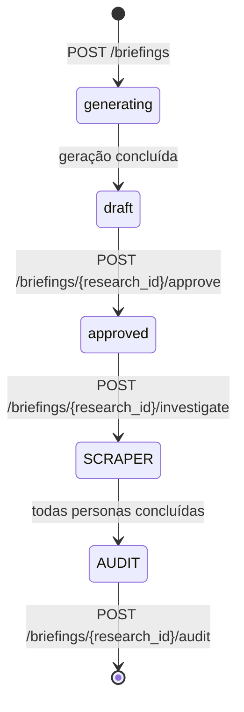

# API de Investigação Paralela por Personas — Referência

> Documentação canônica da API de Investigação Paralela por Personas do Deep Research Engine.
>
> Conforme: `docs/standards/api-docs-standard.md` (snake_case, RFC 9457, envelopes).

---

## 1. Visão Geral

A Investigação Paralela por Personas é a fase de execução do pipeline de pesquisa, acionada após a aprovação de um briefing. Quatro agentes analíticos investigam simultaneamente os pontos aprovados do briefing, coletando evidências, URLs lidas e fontes utilizadas.

**Personas analíticas (investigadores paralelos):**

| Persona | Perfil | Foco |
|---|---|---|
| `historian` | Pesquisador histórico | Fundamentos, contexto, linhagem evolutiva |
| `skeptic` | Crítico cético | Verificação de claim, detecção de vieses, contraprovas |
| `pragmatist` | Engenheiro de aplicação | Viabilidade prática, implementações reais, casos de uso |
| `futurist` | Forecastista | Tendências emergentes, projeções, fronteiras do conhecido |

Cada persona investiga cada ponto aprovado do briefing em paralelo, gerando resultados independentes que são consolidados para a etapa de auditoria subsequente.

---

## 2. Autenticação & Headers

| Tipo | Header / Cookie | Observação |
|---|---|---|
| Bearer Token | `Authorization: Bearer <API_AUTH_SECRET>` | Comparação constante de tempo (`hmac.compare_digest`) |
| Cookie Admin | `Cookie: dr_session=<JWT>` + `X-CSRF-Token: <csrf>` | Obrigatório para mutations |

Para a investigação, o token exigido é de **admin** (`Depends(require_admin)`, `app/core/security.py`).

```http
Accept: application/json
Content-Type: application/json
```

---

## 3. Endpoint: `POST /briefings/{research_id}/investigate`

Dispara a investigação paralela por 4 personas sobre os pontos aprovados do briefing associado à `research_id`.

### 3.1 Parâmetros da Requisição

| Parâmetro | Tipo | Local | Obrigatório | Descrição |
|---|---|---|---|---|
| `research_id` | `uuid` | path | Sim | UUID da pesquisa (identificador canônico compartilhado com o briefing aprovado) |

**Request Body:** Vazio (`{}` ou ausente).

### 3.2 Resposta de Sucesso — `202 Accepted`

Retornado quando a pesquisa existe, está aprovada e os passos são enfileirados para investigação em background.

```json
{
  "research_id": "3fa85f64-5717-4562-b3fc-2c963f66afa6",
  "status": "SCRAPER",
  "message": "Investigação iniciada em background"
}
```

| Campo | Tipo | Descrição |
|---|---|---|
| `research_id` | `uuid` | Identificador da pesquisa investigada |
| `status` | `string` | Novo status: `SCRAPER` (transição aprovado → scraper) |
| `message` | `string` | Mensagem informativa da fila |

### 3.3 Respostas de Erro

#### `401 Unauthorized`

Credencial ausente ou inválida.

```json
{
  "detail": "Credencial inválida ou ausente"
}
```

#### `404 Not Found`

A `research_id` informada não existe na tabela `research`.

```json
{
  "detail": "Pesquisa não encontrada"
}
```

#### `409 Conflict`

Retornado nas seguintes situações:

1. **Briefing não aprovado** — a pesquisa não está no status `SCRAPER` (ou seja, o briefing não foi aprovado).
2. **Investigação já em andamento** — os passos não estão todos em `SCRAPER_PENDING` ou já existem resultados em `research_step_results`.

```json
{
  "detail": "Investigação já iniciada ou em andamento para esta pesquisa"
}
```

---

## 4. Comportamento & Efeitos Colaterais

1. **Validação**: verifica se `research.status == 'SCRAPER'` e se todos os `research_points` associados possuem `status == 'SCRAPER_PENDING'`.
2. **Transição de Estado**: imediatamente após validação, `research_points.status` transitam para `SCRAPER_IN_PROGRESS`.
3. **Fan-out Concorrente**: dispara $N \times 4$ tarefas assíncronas em background via `asyncio.gather(..., return_exceptions=True)`, onde $N$ é o número de pontos do briefing e 4 é o número de personas.
4. **Gravação de Resultados**:
   - Cada persona bem-sucedida grava em `research_step_results` com `status = AUDIT_PENDING`.
   - Cada persona com falha definitiva grava com `status = FAILED` e incrementa `attempt_count` do passo.
5. **Finalização de Passo**:
   - Ao concluir todas as tarefas do passo: o passo fica `AUDIT_PENDING` (se ao menos 1 worker teve sucesso) ou `SCRAPER_FAILED` (se os 4 falharam).
6. **Finalização de Pesquisa**:
   - Ao concluir todos os passos: `research.status` transita para `AUDIT` (ou `FAILED` se todos os passos forem `SCRAPER_FAILED`).

---

## 5. Ciclo de Vida & Tabela `research_step_results`

Resultados individuais de cada persona são armazenados na tabela `research_step_results`, que segue ciclo de vida append-only.

| Coluna | Tipo | Descrição |
|---|---|---|
| `research_id` | `uuid` | Identificador da pesquisa (FK → `research`) |
| `step_id` | `uuid` | Identificador do passo de pesquisa (FK → `research_points`) |
| `step_title` | `string` | Título do ponto investigado |
| `result` | `text` | Conteúdo da investigação (narrativa estruturada da persona) |
| `used_urls` | `array<string>` | URLs das fontes consultadas (busca/SERP) |
| `read_urls` | `array<string>` | URLs retornadas pela ferramenta Jina durante a investigação da persona |
| `worker` | `string` | Identificação da persona: `historian`, `skeptic`, `pragmatist`, `futurist` |
| `status` | `string` | Status do resultado: `AUDIT_PENDING`, `FAILED` |

**Observações:**

- Uma persona investiga cada passo exatamente uma vez; a tabela é populada incrementalmente à medida que as tarefas assíncronas completam, registrando uma linha por tentativa (research_id, step_id, worker).
- `result` contém a narrativa da persona, estruturada segundo o template de prompt correspondente.

---

## 6. Exemplos

### Exemplo 1 — Disparo bem-sucedido

```bash
curl -s -X POST \
  -H "Authorization: Bearer <ADMIN_TOKEN>" \
  -H "Content-Type: application/json" \
  http://localhost:8000/briefings/3fa85f64-5717-4562-b3fc-2c963f66afa6/investigate \
  -d '{}' | jq '.'
```

**Resposta — `202 Accepted`:**

```json
{
  "research_id": "3fa85f64-5717-4562-b3fc-2c963f66afa6",
  "status": "SCRAPER",
  "message": "Investigação iniciada em background"
}
```

### Exemplo 2 — Briefing não aprovado (409)

```bash
curl -s -X POST \
  -H "Authorization: Bearer <ADMIN_TOKEN>" \
  http://localhost:8000/briefings/3fa85f64-5717-4562-b3fc-2c963f66afa6/investigate
```

```json
{
  "detail": "Investigação já iniciada ou em andamento para esta pesquisa"
}
```

### Exemplo 3 — Pesquisa não encontrada (404)

```bash
curl -s -X POST \
  -H "Authorization: Bearer <ADMIN_TOKEN>" \
  http://localhost:8000/briefings/00000000-0000-0000-0000-000000000000/investigate
```

```json
{
  "detail": "Pesquisa não encontrada"
}
```

---

## 7. Integração com o Pipeline



---

## Navegação

| Direção | Link |
|---|---|
| Padrão de docs | `docs/standards/api-docs-standard.md` |
| API de Briefing / Scout | `docs/api/briefing-scout.md` |
| API de Jobs (pipeline) | `docs/api/jobs.md` |
| Arquitetura geral | `README.md` |
