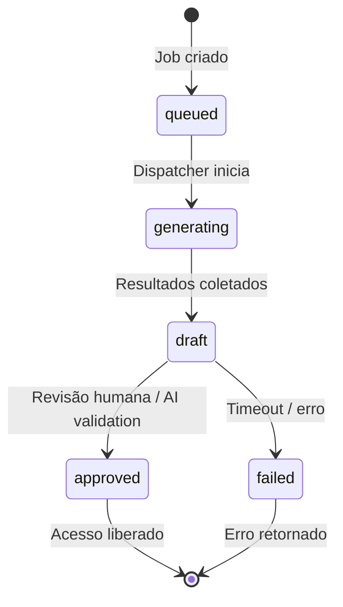

# Padrão de Documentação de APIs

<!--
  ESTE ARQUIVO é o padrão canônico para documentação de APIs do Deep Research Engine.
  Inspirado em:
    - n8n Docs (https://docs.n8n.io)
    - Google Cloud API Design Guide (https://cloud.google.com/apis/design)
    - Vercel Engineering Playbook (https://engineering-playbook.vercel.app)
    - Stripe API Reference (https://docs.stripe.com/api)

  Uso: copie este template para cada recurso/endpoint e preencha os blocos.
  A documentação deve ser gerada a partir do código-fonte (OpenAPI-first) e
  validada em CI.
-->

> [!NOTE]
> Este documento define o **formato canônico** de documentação de APIs. Cada
> recurso (resource) ou grupo de endpoints deve ter seu próprio arquivo
> `docs/api/<recurso>.md` estruturado conforme especificado abaixo.

---

## 1. Princípios Fundamentais

| Princípio | Regra | Exemplo |
|---|---|---|
| **Developer Experience (DX) em primeiro lugar** | O leitor deve conseguir fazer algo útil em menos de 3 minutos. | QuickStart executável com cURL. |
| **Escaneabilidade** | Toda página deve ser percorrida por headings hierárquicos (H1 → H4). Nenhum parágrafo maior que 3 linhas. | Headings descritivos e específicos. |
| **Exemplos copiáveis e executáveis** | Todo código deve ser copiado e colado e funcionar sem edição (exceto substituição de secrets). | Use valores de teste reais, nunca `<YOUR_VALUE_HERE>`. |
| **Consistência** | Mesmo padrão em todos os recursos. Use templates. | Tabelas alinhadas, mesmo schema de referência. |
| **Machine-readability** | Estrutura previsível: assinaturas em blocos de código, parâmetros em tabelas, schemas definidos. | Compatível com agentes LLM e geradores de SDK. |
| **Versionamento** | Documentação deve refletir a versão atual da API. Breaking changes exigem nova versão. | SemVer para a API: `v1`, `v2`. |

---

## 2. Estrutura Canônica de Documentação de Recurso/API

Cada recurso deve ter um arquivo Markdown com **exatamente** as seções abaixo, nesta ordem.

### 2.1 Visão Geral & Casos de Uso

Comece com uma única frase que responde: *"O que este recurso permite fazer?"*

```markdown
# Jobs

Crie, liste e monitore jobs de pesquisa do Deep Research Engine.
```

> [!NOTE]
> Frase direta, sem pronome "ele/ela", sem "este recurso permite".

**Casos de uso típicos** (lista não numerada):

- Criar um job de pesquisa com query textual e recuperar resultados
- Consultar status de um job em andamento
- Cancelar um job antes da conclusão
- Exportar resultados de um job concluído

### 2.2 Autenticação e Headers Requeridos

Documente o mecanismo de autenticação e todos os headers necessários.

| Header | Obrigatório | Descrição | Exemplo |
|---|---|---|---|
| `Authorization` | Sim | Bearer token (JWT ou API Key). | `Bearer sk-1234567890abcdef` |
| `Content-Type` | Sim (para bodies) | Tipo do conteúdo do body. | `application/json` |
| `Accept` | Sim | Versão da API via header. | `application/vnd.dre.v1+json` |
| `X-Request-ID` | Não | ID para rastreamento em logs. | `req_abc123` |

> [!TIP]
> Para chamadas de teste, use a API Key de teste exposta no painel do desenvolvedor.

### 2.3 Quickstart (cURL executável em ~3 minutos)

Forneça um caminho completo, do zero, com comandos reais e valores de teste.

```bash
# 1. Crie um job de pesquisa
JOB_ID=$(curl -s \
  -H "Authorization: Bearer $DRE_API_KEY" \
  -H "Content-Type: application/json" \
  -H "Accept: application/vnd.dre.v1+json" \
  https://api.deepresearchengine.com/v1/jobs \
  -d '{"query": "impacto da IA na medicina"}');

echo "Job criado: $JOB_ID"

# 2. Aguarde conclusão (poll a cada 5s)
while true; do
  STATUS=$(curl -s \
    -H "Authorization: Bearer $DRE_API_KEY" \
    -H "Accept: application/vnd.dre.v1+json" \
    https://api.deepresearchengine.com/v1/jobs/$JOB_ID \
    | python3 -c "import sys,json; print(json.load(sys.stdin)['status'])");

  echo "Status: $STATUS"
  if [[ "$STATUS" == "completed" || "$STATUS" == "failed" ]]; then break; fi
  sleep 5

done

# 3. Baixe resultados
curl -s \
  -H "Authorization: Bearer $DRE_API_KEY" \
  -H "Accept: application/vnd.dre.v1+json" \
  https://api.deepresearchengine.com/v1/jobs/$JOB_ID/results \
  > results.json
```

> [!WARNING]
> Substitua `$DRE_API_KEY` por sua chave de API de teste antes de executar.

### 2.4 Diagrama ou Descrição do Ciclo de Vida / Máquina de Estados



**Transições válidas:**

| De | Para | Gatilho | Observação |
|---|---|---|---|
| `queued` | `generating` | Dispatcher inicia processo | |
| `generating` | `draft` | Resultados coletados e agrupados | |
| `draft` | `approved` | Aprovação automática ou humana | |
| `draft` | `failed` | Timeout, erro de LLM, ou conteúdo bloqueado | |
| `approved` | `failed` | Detecção de conteúdo inadequado pós-aprovação | |

### 2.5 Referência de Endpoints

#### `POST /v1/jobs`

Cria um novo job de pesquisa.

| Campo | Tipo | Obrigatório | Restrições | Default | Descrição |
|---|---|---|---|---|---|
| `query` | `string` | Sim | 1–500 caracteres | — | Texto da consulta de pesquisa. |
| `model` | `string` | Não | Enum: `gpt-4o`, `claude-3-5-sonnet`, `gemini-2.0-flash` | `gpt-4o` | Modelo LLM a utilizar. |
| `max_results` | `integer` | Não | 1–100 | `10` | Número máximo de resultados. |
| `lang` | `string` | Não | ISO 639-1 (`en`, `pt`, `es`, ...) | `en` | Idioma dos resultados. |

**Request:**

```bash
curl -X POST \
  -H "Authorization: Bearer $DRE_API_KEY" \
  -H "Content-Type: application/json" \
  -H "Accept: application/vnd.dre.v1+json" \
  https://api.deepresearchengine.com/v1/jobs \
  -d '{
    "query": "impacto da IA na medicina",
    "model": "gpt-4o",
    "max_results": 5
  }'
```

**Response `200 OK`:**

```json
{
  "id": "job_abc123",
  "query": "impacto da IA na medicina",
  "model": "gpt-4o",
  "max_results": 5,
  "lang": "en",
  "status": "queued",
  "created_at": "2025-01-15T10:30:00Z",
  "updated_at": "2025-01-15T10:30:00Z"
}
```

**Schema JSON de resposta:**

| Campo | Tipo | Descrição |
|---|---|---|
| `id` | `string` | Identificador único do job. Formato: `job_<id>`. |
| `query` | `string` | Consulta original enviada pelo cliente. |
| `model` | `string` | Modelo LLM utilizado. |
| `max_results` | `integer` | Limite de resultados. |
| `lang` | `string` | Código ISO 639-1 do idioma. |
| `status` | `string` | Estado atual do job. |
| `created_at` | `string (ISO 8601)` | Timestamp de criação. |
| `updated_at` | `string (ISO 8601)` | Timestamp da última atualização. |

---

#### `GET /v1/jobs/{id}`

Retorna os detalhes de um job específico.

| Parâmetro | Localização | Tipo | Obrigatório | Descrição |
|---|---|---|---|---|
| `id` | path | `string` | Sim | Identificador do job (`job_<id>`). |
| `expand` | query | `string` | Não | Campos a expandir. Ex: `results`. |

**Response `200 OK`:** (mesmo schema do `POST`, com `status` atualizado)

---

#### `GET /v1/jobs/{id}/results`

Retorna os resultados coletados de um job concluído.

| Parâmetro | Localização | Tipo | Obrigatório | Descrição |
|---|---|---|---|---|
| `id` | path | `string` | Sim | Identificador do job. |
| `limit` | query | `integer` | Não | Limite de resultados. Default: `10`. |
| `offset` | query | `integer` | Não | Índice inicial. Default: `0`. |

**Response `200 OK`:**

```json
{
  "results": [
    {
      "title": "IA na Medicina: Uma Revisão Sistemática",
      "url": "https://example.com/paper/ia-medicina",
      "snippet": "Este estudo revisa aplicações da IA na medicina...",
      "source": "PubMed",
      "published_at": "2025-01-10T08:00:00Z"
    }
  ],
  "total": 5,
  "has_more": false
}
```

**Schema JSON de resposta:**

| Campo | Tipo | Descrição |
|---|---|---|
| `results` | `array<object>` | Lista de resultados. |
| `results[].title` | `string` | Título do resultado. |
| `results[].url` | `string` | URL da fonte. |
| `results[].snippet` | `string` | Trecho resumido. |
| `results[].source` | `string` | Nome da fonte. |
| `results[].published_at` | `string (ISO 8601)` | Data de publicação. |
| `total` | `integer` | Total de resultados. |
| `has_more` | `boolean` | Se há mais resultados. |

---

### 2.6 Matriz de Tratamento de Erros

> [!IMPORTANT]
> Todos os erros seguem o formato RFC 9457 (Problem Details for HTTP APIs).

| HTTP Status | Código de Erro | Causa | Payload de Erro |
|---|---|---|---|
| `400` | `invalid_request` | Body da requisição é inválido ou falta parâmetro obrigatório. | `{"type":"about:blank","title":"Bad Request","status":400,"detail":"Missing required field: query","instance":"/v1/jobs"}` |
| `401` | `unauthorized` | API Key inválida, expirada ou ausente. | `{"type":"about:blank","title":"Unauthorized","status":401,"detail":"Invalid API key","instance":"/v1/jobs"}` |
| `403` | `forbidden` | API Key não tem permissão para este recurso. | `{"type":"about:blank","title":"Forbidden","status":403,"detail":"Insufficient permissions","instance":"/v1/jobs"}` |
| `404` | `not_found` | Job ID não encontrado. | `{"type":"about:blank","title":"Not Found","status":404,"detail":"Job job_xyz789 not found","instance":"/v1/jobs/job_xyz789"}` |
| `409` | `conflict` | Job já existe com a mesma query (deduplicação). | `{"type":"about:blank","title":"Conflict","status":409,"detail":"Job already exists","instance":"/v1/jobs"}` |
| `429` | `rate_limited` | Limite de requisições excedido. | `{"type":"about:blank","title":"Too Many Requests","status":429,"detail":"Rate limit exceeded. Retry after 30s","instance":"/v1/jobs"}` |
| `500` | `internal_error` | Erro interno do servidor. | `{"type":"about:blank","title":"Internal Server Error","status":500,"detail":"Unexpected error. Reference: err_abc123","instance":"/v1/jobs"}` |
| `503` | `service_unavailable` | Serviço temporariamente indisponível (manutenção ou LLM offline). | `{"type":"about:blank","title":"Service Unavailable","status":503,"detail":"Backend temporarily unavailable. Retry after 60s","instance":"/v1/jobs"}` |

> [!TIP]
> Para testar erros de forma programática, envie um body inválido e verifique se a resposta contém o campo `detail` explicando o problema.

#### Formato de Erro Detalhado (RFC 9457)

```json
{
  "type": "https://api.deepresearchengine.com/errors/invalid_request",
  "title": "Bad Request",
  "status": 400,
  "detail": "Missing required field: query",
  "instance": "/v1/jobs",
  "request_id": "req_abc123",
  "errors": [
    {
      "field": "query",
      "code": "missing",
      "message": "The 'query' field is required."
    }
  ]
}
```

| Campo | Tipo | Descrição |
|---|---|---|
| `type` | `string (uri)` | URI documentando o tipo de erro. |
| `title` | `string` | Título curto do erro. |
| `status` | `integer` | Código HTTP. |
| `detail` | `string` | Descrição legível por humanos. |
| `instance` | `string` | Path da requisição. |
| `request_id` | `string` | ID da requisição para suporte. |
| `errors` | `array<object>` | Lista de erros de validação (quando aplicável). |

### 2.7 Guia de Configuração e Variáveis de Ambiente

> [!NOTE]
> As variáveis abaixo são configuradas no serviço de API, não pelo cliente. Clientes só enviam headers de autenticação.

| Variável | Escopo | Default | Criticidade | Descrição |
|---|---|---|---|---|
| `DRE_API_BASE_URL` | Server | `https://api.deepresearchengine.com` | Alta | URL base da API. |
| `DRE_LLM_PROVIDER` | Server | `openai` | Alta | Provedor LLM (`openai`, `anthropic`, `gemini`). |
| `DRE_MAX_CONCURRENCY` | Server | `10` | Média | Número de jobs processados em paralelo. |
| `DRE_RESULT_TTL_HOURS` | Server | `24` | Média | Tempo de vida dos resultados em cache. |
| `DRE_RATE_LIMIT_PER_MINUTE` | Server | `60` | Alta | Limite de requisições por minuto por API Key. |
| `DRE_JINA_API_KEY` | Server | — | Alta | API Key do Jina para embeddings/search. |
| `DRE_LOG_LEVEL` | Server | `INFO` | Baixa | Nível de log (`DEBUG`, `INFO`, `WARNING`, `ERROR`). |

### 2.8 Exemplos Práticos de Código

#### cURL

```bash
# Criar job
curl -X POST \
  -H "Authorization: Bearer $DRE_API_KEY" \
  -H "Content-Type: application/json" \
  -H "Accept: application/vnd.dre.v1+json" \
  https://api.deepresearchengine.com/v1/jobs \
  -d '{"query": "impacto da IA na medicina", "model": "gpt-4o", "max_results": 5}'

# Consultar status
curl -s \
  -H "Authorization: Bearer $DRE_API_KEY" \
  -H "Accept: application/vnd.dre.v1+json" \
  https://api.deepresearchengine.com/v1/jobs/job_abc123 | jq '.status'

# Obter resultados
curl -s \
  -H "Authorization: Bearer $DRE_API_KEY" \
  -H "Accept: application/vnd.dre.v1+json" \
  https://api.deepresearchengine.com/v1/jobs/job_abc123/results | jq '.results'
```

#### Python (requests)

```python
import os, time, requests

API_KEY = os.getenv("DRE_API_KEY")
BASE = "https://api.deepresearchengine.com/v1"
H = {
    "Authorization": f"Bearer {API_KEY}",
    "Content-Type": "application/json",
    "Accept": "application/vnd.dre.v1+json",
}

# 1. Criar job
resp = requests.post(f"{BASE}/jobs", headers=H, json={
    "query": "impacto da IA na medicina",
    "max_results": 5,
})
job_id = resp.json()["id"]

# 2. Poll até conclusão
while True:
    r = requests.get(f"{BASE}/jobs/{job_id}", headers=H)
    status = r.json()["status"]
    if status in ("completed", "failed"):
        break
    time.sleep(5)

# 3. Obter resultados
if status == "completed":
    r = requests.get(f"{BASE}/jobs/{job_id}/results", headers=H)
    print(r.json()["results"])
else:
    print("Job falhou:", r.json().get("detail"))
```

#### TypeScript (Fetch API)

```typescript
const API_KEY = process.env.DRE_API_KEY!;
const BASE = "https://api.deepresearchengine.com/v1";
const H = {
  Authorization: `Bearer ${API_KEY}`,
  "Content-Type": "application/json",
  Accept: "application/vnd.dre.v1+json",
};

// 1. Criar job
const createRes = await fetch(`${BASE}/jobs`, {
  method: "POST",
  headers: H,
  body: JSON.stringify({ query: "impacto da IA na medicina", max_results: 5 }),
});
const job = await createRes.json();

// 2. Poll até conclusão
let status = "queued";
while (status !== "completed" && status !== "failed") {
  await new Promise(r => setTimeout(r, 5000));
  const res = await fetch(`${BASE}/jobs/${job.id}`, { headers: H });
  const data = await res.json();
  status = data.status;
}

// 3. Obter resultados
if (status === "completed") {
  const res = await fetch(`${BASE}/jobs/${job.id}/results`, { headers: H });
  const data = await res.json();
  console.log(data.results);
} else {
  console.error("Job falhou");
}
```

---

## 3. Padrões Visuais de Formatação

### 3.1 Tabelas Markdown

- Sempre use alinhamento explícito de pipes (`|`).
- Header sempre separado por `---`.
- Colunas: `Tipo | Obrigatório | Default | Restrições | Descrição`.

```markdown
| Campo | Tipo | Obrigatório | Default | Descrição |
|---|---|---|---|---|
| `query` | `string` | Sim | — | Consulta de pesquisa. |
```

### 3.2 Callouts do GitHub

| Tipo | Uso | Exemplo |
|---|---|---|
| `> [!NOTE]` | Contexto adicional, informação neutra. | Explicação de um conceito. |
| `> [!TIP]` | Dica prática, truque ou atalho. | Como testar rapidamente. |
| `> [!WARNING]` | Atenção: algo que pode causar problema. | Substituir chave de API antes de rodar. |
| `> [!IMPORTANT]` | Ação ou informação crítica para sucesso. | Todos os erros seguem RFC 9457. |

### 3.3 Convenções de JSON e Nomeação

| Convenção | Regra | Exemplo |
|---|---|---|
| **naming** | `snake_case` para campos JSON. | `created_at`, `max_results` |
| **tipos** | Use nomes de tipos OpenAPI 3.0. | `string`, `integer`, `boolean`, `array`, `object` |
| **timestamps** | ISO 8601 com `Z`. | `2025-01-15T10:30:00Z` |
| **IDs** | Prefixed IDs com underscore. | `job_abc123`, `user_x7y9z` |
| **booleans** | `has_more`, `is_active` (não `hasMore`). | — |
| **envelopes** | Coleções retornam `{ data: [], meta: {...} }` ou `{ results: [], total, has_more }`. | — |
| **nullable** | Omita campo ou use `null`. Nunca string vazia para ausência de valor. | `"published_at": null` |

---

## 4. Checklist de Publicação

- [ ] OpenAPI spec está atualizado e validado (`openapi.yaml`)
- [ ] QuickStart executado localmente com sucesso
- [ ] Todos os endpoints têm exemplos de request + response completos
- [ ] Todos os erros possíveis estão na matriz de tratamento de erros
- [ ] Variáveis de ambiente documentadas
- [ ] Exemplos em cURL, Python e TypeScript validados
- [ ] Callouts apropriados usados (`NOTE`, `TIP`, `WARNING`, `IMPORTANT`)
- [ ] Tabelas alinhadas e legíveis em Markdown
- [ ] Link para estações anteriores e próximas (navegação)

---

## 5. Referências Externas

| Fonte | URL |
|---|---|
| n8n API Documentation | https://docs.n8n.io/connect/n8n-api/ |
| n8n Style Guide | https://docs.n8n.io/contribute/contribution-guide-for-n8n-docs/style-guide-for-n8n-docs |
| Google Cloud API Design Guide | https://cloud.google.com/apis/design |
| Google API Improvement Proposals (AIPs) | https://google.aip.dev |
| Vercel API Design Walk-through | https://engineering-playbook.vercel.app/api-design |
| Vercel Agent-Friendly Docs | https://vercel.com/academy/agent-friendly-apis/agent-friendly-docs |
| Stripe API Reference | https://docs.stripe.com/api |
| Stripe Error Codes | https://docs.stripe.com/error-codes |
| RFC 9457 — Problem Details for HTTP APIs | https://datatracker.ietf.org/doc/html/rfc9457 |
| llms.txt Standard | https://llmstxt.org |
